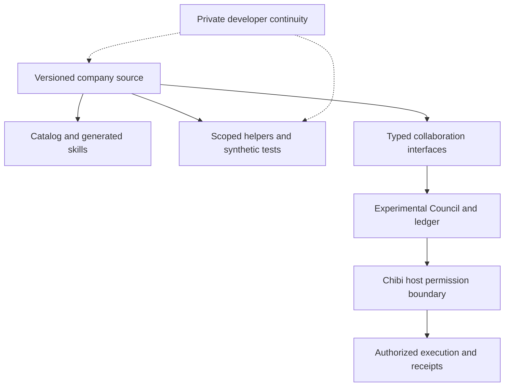

# Architecture and source-of-truth map

Private source: [SalesSquad/junction-pets](https://github.com/SalesSquad/junction-pets).
Private runtime: [SalesSquad/chibi](https://github.com/SalesSquad/chibi).
Read [contributor rules](AGENTS.md) for authority; this map describes boundaries,
not deployment or permission grants.

## Three separate planes

Solid arrows are source/interface relationships, not proof of live connections.
Dotted arrows are development tooling. The public-facing catalog is discovery;
the private developer plane manages code; only Chibi may authorize runtime work.

## Components, contracts and owners

| Component | Canonical source | Owner / invariant |
| --- | --- | --- |
| Company package | `pets/<company>/`, `tests/pet-<company>.test.mjs` | One writer; stable identity/version, citations, runtime persona, three use cases, six authored evals and scoped source checks |
| Package schema | `catalog-contract.md`, `schemas/` | Integrator; exact shared shape and release/version rules |
| Generated plugins | `plugins/junction-<company>/`, plugin producer | Three skills-only outputs; source-bound content, no implicit helper/tool execution |
| Catalog/export | `apps/catalog/`, shared `lib/` and `scripts/` | Catalog/integrator; public-safe projections only; `dist/` is generated |
| Collaboration envelope | `contracts/pet-collaboration/v1/` | Contract owner; proposed request/receipt shapes, not a grant or signature |
| Council | `services/council/` | Host-injected Python LangGraph/FastAPI orchestration; no anonymous default host or permission issuer |
| Dispatch persistence | `services/dispatch-ledger/` | PostgreSQL-oriented lease/fencing/checkpoint interfaces and test adapters; no implied live database |
| Developer plane | `ops/`, `scripts/ops-*.mjs`, `apps/mission-control/` | Integrator; private manifests, finite task records and derived snapshots |
| Runtime/identity | Separate private Chibi repository | Accounts, offers, consent, Cedar policy, tenant isolation, real providers/tools, payment and private memory |

The four required company content files are `pet.json`, `AGENTS.md`,
`STORY.md`, `evals.json`. Source helpers, invented examples and contracts are
additional files. A company's persona cannot authorize a developer. Helper
tests are not the six model evals, and helpers are not automatically exported as
runtime/plugin tools. Read each helper's exact contract before reuse.

## Developer continuity: data, not a daemon

| Record | Meaning | Cannot establish |
| --- | --- | --- |
| `ops/environments/<company>.json` | Desired configuration, stable logical owner and dated provider evidence | Fresh selectability, capacity or an active job |
| `ops/development-progress.json` | 34 finite source tasks with reviewed author HEAD, actual executor, PR, original checks and next proposal | Always-on workers, authenticated receipt truth or current full-suite success |
| Company scope SHA-256 | Tracked company paths, actual modes and bytes at a verified source checkpoint | Unrelated/shared source freshness, remote HEAD, provider/host health |
| Local `ops-work` lease | Atomic ownership inside one shared filesystem | A distributed lock across isolated Cloud workspaces |
| Derived Mission Control | Dated read-only presentation of supplied records | A live Cloud API, grant issuer or background dispatcher |

Use the [continuity reader](docs/DEVELOPER_CONTINUITY.md): compact summary by
default, `--pet <company>` for one record, `--check` to reject stale/missing
company bytes. It is read-only/offline and labels live qualifications unverified.
Only the integrator updates the checkpoint after independent source review.
The final `npm run verify:source` gate includes the real ledger drift check;
it never generates a new digest to mask a stale one. Unit tests use synthetic
roots, so ordinary author tests do not depend on mutable live ledger contents.
Each finite writer releases ownership; its next action remains unstarted until
a new task receives an actual executor, source pin and exclusive scope.

Historical [provisioning](ops/cloud-provisioning-20261113.json) and
[early queue](ops/development-queue-20261113.json) observations remain intact.
Legacy environment IDs were not interchangeable with the later Cloud picker.
The existing completion monitor is not a fleet dispatcher. See the
[Cloud playbook](docs/CLOUD_DEVELOPER_PLAYBOOK.md) for supported admission and
portable fallback; no Mac is required for Node/Python synthetic source work.

## Chibi trust boundary

For real execution, the host must independently bind tenant, actor, recipient,
approved source, context, capability, effect, time, budget and lineage. It then
checks consent, Cedar policy, entitlement, revocation and idempotency at the
privileged operation and artifact read—not just at initial delegation.

The Council cannot mint a grant. Supplied `sourceSha`, `authorityRef` or a
schema-valid trace is not authenticated authority. Durable dispatch must retain
fencing/replay rules; accepted output must match source/tenant/lineage/digest;
a real result needs the host's signed receipt.

[Chibi PR #113](https://github.com/SalesSquad/chibi/pull/113) merged a tested,
disabled host-private admission seam (119 Rust passes, four pre-existing
PostgreSQL tests ignored, 12 targeted checks). [PR #116](https://github.com/SalesSquad/chibi/pull/116)
added source catalog discoverability (34 records, 30 curated queries, 57 catalog
checks), not runtime activation. No live HTTP/MCP route, real delegated model
task, signed host receipt or recipient acceptance is implied.

## Verification tiers and change protocol

Authored content → exact-source portable tests → separately authorized provider
proof → tenant-scoped host/recipient proof → authorized release are distinct
qualifications. Passing an earlier tier never silently advances another.
204 behavior cases are authored definitions; synthetic success is not model
quality. Partial-asset builds do not qualify browser/artwork acceptance.

Company writers keep disjoint scope; service specialists own explicit subtrees;
one integrator owns overlaps, generators, private ledger and final combined HEAD.
An independent read-only reviewer checks those exact bytes. Preserve old failed
receipts and counts, rerun decisive combined gates, and record architectural
changes explicitly in the same PR. No force/direct-main push, public code export,
new spending, permission change or deployment is authorized by this document.

Aiven/LangGraph reuse retains pinned public-source license notices. Earlier
[Claude architecture advice](docs/CLAUDE_ARCHITECTURE_REVIEW.md) informed the
separation above; it was brief-only advice, not approval of current source.
See [development system](docs/DEVELOPMENT_SYSTEM.md),
[submission boundary](docs/JUNCTION_SUBMISSION.md) and
[Chibi integration](docs/CHIBI_INTEGRATION.md) for focused detail.
