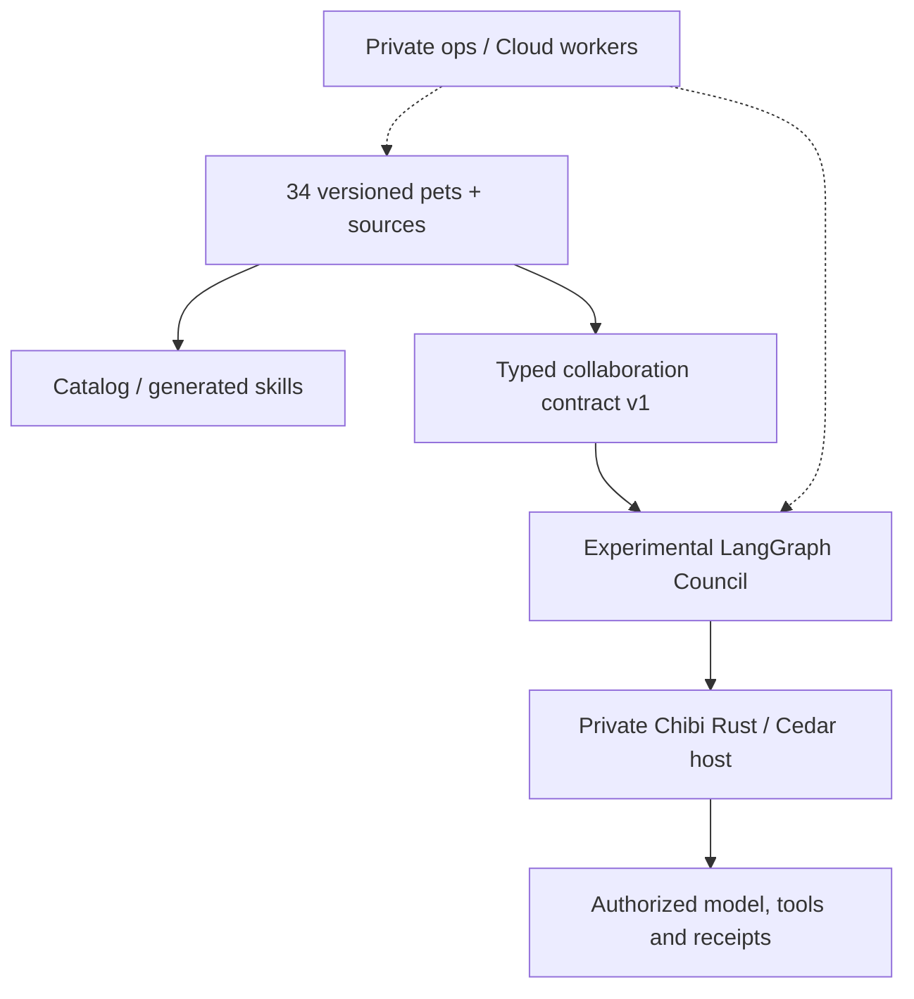

# Junction Pets — architecture and source-of-truth map

**Audience:** agents joining any company lane, integrators, reviewers and the human owner. **Scope:** the private [`SalesSquad/junction-pets`](https://github.com/SalesSquad/junction-pets) monorepo; **runtime boundary:** the separate private [`SalesSquad/chibi`](https://github.com/SalesSquad/chibi). Read [`AGENTS.md`](AGENTS.md) for mandatory development behavior and [`docs/CLOUD_DEVELOPER_PLAYBOOK.md`](docs/CLOUD_DEVELOPER_PLAYBOOK.md) for continuity.

## Architecture at a glance

Solid arrows show intended data/interface relationships, **not proof of live connections**. Dotted arrows are developer tooling. The Council and any Aiven/PostgreSQL adapter are not identity providers, grant issuers or production hosts. The private Chibi host owns the authorization decision, actual execution and user data; it must independently verify source and policy on each privileged use. The catalog is a discovery/export surface, not a second Chibi.

## Monorepo components and boundaries

| Component | Canonical paths | Contract and ownership |
| --- | --- | --- |
| Company facts and behavior | [`pets/`](pets/), [`evidence/company-roster.json`](evidence/company-roster.json) | Exactly 34 packages. Each owns its stable slug/id, version, three user cases, public source citations, persona and six authored eval cases. One pet-content author per owned directory. |
| Package format | [`catalog-contract.md`](catalog-contract.md), [`schemas/`](schemas/) | Shared schema, identifiers, package validation and release policy; changed only by the integrator. |
| Catalog and safe export | [`apps/catalog/`](apps/catalog/), [`lib/`](lib/), [`scripts/`](scripts/), [`config/host-config.json`](config/host-config.json) | Public discovery, previews, QR and export adapters. Requires a verified host binding before claiming an adoption path. Generated `dist/` is derivative, not an editable source of truth. |
| Cross-pet interface | [`contracts/pet-collaboration/v1/`](contracts/pet-collaboration/v1/) | Versioned request and receipt shapes. Untrusted user-supplied `sourceSha`/`authorityRef` fields never confer permission without trusted host verification. |
| Council | [`services/council/`](services/council/) | Experimental, Aiven-inspired Python LangGraph/FastAPI host-injected orchestration. Builds a bounded, interruptible sequence; it has no default anonymous server, authority or private-data store. See its [README](services/council/README.md) and pinned upstream MIT license attribution. |
| Ledger/continuity | [`services/dispatch-ledger/`](services/dispatch-ledger/) | Durable PostgreSQL-oriented leases/fencing/checkpoint/receipt primitives and test adapters. A valid schema or test is not proof of a live database, exactly-once execution or hosted persistence. |
| Development control plane | [`ops/`](ops/), [`apps/mission-control/`](apps/mission-control/), `scripts/ops-*.mjs` | **Private** desired environment manifests, per-company agent IDs, task leases, source-bound receipts and derived status. Never added wholesale to public Junction export. |
| Skills-only plugin artifacts | [`plugins/`](plugins/), [`docs/PET_PLUGINS.md`](docs/PET_PLUGINS.md) | 34 registered private Plugin Creator packages with pinned source digests; registration is neither live Chibi installation nor provider/memory permission. |
| Chibi runtime | Separate [`SalesSquad/chibi`](https://github.com/SalesSquad/chibi) | Accounts, invitation, offers, entitlement, consent, tenant isolation, Cedar policy enforcement, real provider calls, money, private chat/memory and signed host receipts. **Never vendor its private code or credentials into this repo.** |

The four files in each `pets/<company>/` package are `pet.json` (machine identity/behavior metadata), `AGENTS.md` (runtime persona and constraints), `STORY.md` (user-facing narrative and Finnish summary) and `evals.json` (six **authored**, not executed, model test definitions). Root [`AGENTS.md`](AGENTS.md) and [`ops/AGENTS.md`](ops/AGENTS.md) are **developer instructions**, not runtime prompts.

## Identity, permissions and execution

The portable `pet-collaboration.v1` envelope is only a **proposal**. For any real workflow:

1. Bind the authenticated Chibi tenant, actor, recipient, approved source revision, context reference, effect, capability, time window, budget and request lineage **inside the host**, not in a model-generated assertion.
2. Consult host-managed consent, Cedar authorization, entitlement, current revocation and idempotency policy. Deny by default if unknown or expired. A model/Council/Cloud developer may not issue grants.
3. Persist bounded dispatch with durable idempotency/fencing. Recheck token and authorization before each provider/tool operation and at the actual artifact read, including between Council steps.
4. Accept the first producer artifact for a child only through host-verified tenant/source/lineage/digest rules; do not use shared cross-pet memory or untrusted prior output as an authorization token.
5. Bind the result to immutable source, exact request, provider/tool IDs, input/output digests and a **host-attested** receipt. A JSON schema-valid receipt or a Council-generated trace is not a cryptographic signature.

This is the intended secure execution contract, **not** a claim of hosted deployment or recipient acceptance. Private [Chibi PR #113](https://github.com/SalesSquad/chibi/pull/113) was compiled, independently reviewed and merged at `5913e0aa696895024a4852d525289dcaa1fb5949`: 119 Rust unit tests passed, four pre-existing PostgreSQL tests were **ignored**, and 12 targeted collaboration tests passed. The source seam is explicitly **disabled**—no live HTTP/MCP route, provider/model dispatch, signed host receipt or recipient authorization is wired. [Chibi PR #116](https://github.com/SalesSquad/chibi/pull/116) added catalog discoverability at `c775341193507f745d6fbd30e320a3b5cf8a4ef3` (34 catalog records, 30/30 curated search cases, 57/57 catalog unit tests), not runtime activation. Follow the implementation truth in [`contracts/pet-collaboration/v1/README.md`](contracts/pet-collaboration/v1/README.md) and [`services/council/README.md`](services/council/README.md). Aiven code adaptation is public-source/MIT-attributed at pinned SHAs; Aiven hosting, credentials and sponsor endorsement are never assumed.

## Developer fleet as a separate plane

`ops/environments/<company>.json` is the machine-readable **desired state** for each logical developer, validated by [`ops/registry.mjs`](ops/registry.mjs):

| Field | Example for Aiven | Meaning |
| --- | --- | --- |
| `petSlug` | `junction-aiven` | Stable pet identity |
| `agentId` | `junction-dev-aiven` | Stable **logical developer** identity, not an always-running process |
| `desiredName` | `junction-aiven` | Requested Codex Cloud environment name |
| `ownedPath` | `pets/aiven/` | Default exclusive writer scope |
| `branchPattern` | `codex/junction-aiven-*` | Task branches; no permanent per-company branch requirement |
| `provisioning` | `ready`, actual provider ID | Dated Pro/Legacy settings readback; local status remains `reported-ready` pending a fresh trusted provider check |

**Earlier W5 source snapshot, 13 November:** 34 valid manifests, 34 logical agent IDs, **33 unprovisioned** and Aiven `published-id-pending` with no immutable environment ID. The 102 code/test/review roles in the [older Wave 2 plan](docs/JUNCTION_SWARM_WAVE2_EXECUTION.md) are a capacity-limited **future roster**, not 102 active tasks. A Cloud environment is reusable configuration; a running task is an independently evidenced, time-bounded job. The [Wave 3 Codex Cloud Node test task](https://chatgpt.com/local/6af64d73-352c-8191-b84d-a8c2dc328042) is **not** a provider ID for those 34 manifests.

**W8 provisioning update, 13 November 2026:** all 34 Pro/Legacy environments now have actual provider IDs, individual settings readbacks and prior source-bound Cloud task evidence in [the private provisioning record](ops/cloud-provisioning-20261113.json). The manifests permit dry-run planning; a fresh account/provider/source check and bounded work ownership remain required for each task. This does not qualify Chibi runtime, model evaluations or an autonomous Fleet adapter.

**Continuation checkpoint, 13 November:** the [source-controlled work queue](docs/DEVELOPMENT_QUEUE.md) records one reviewed/merged Aiven source slice ([PR #11](https://github.com/SalesSquad/junction-pets/pull/11)), two observed running Cloud development tasks ([MariaDB](https://chatgpt.com/local/6af6b88c-3af4-8191-a1f3-84bb3805b0e3), [AfterQuery](https://chatgpt.com/local/6af6b96a-4ed0-8191-9f36-61dcf4ac70cf)) and 31 unstarted proposals. These actual tasks use a separately selected `chibi-marketplace-cloud` executor. MariaDB's source pin was checked by its worker; AfterQuery's source pin was still in preflight at the observation. Legacy ID bindings are historical provider settings, not evidence that the new Cloud picker can select them. All source-only checks remain distinct from model/Chibi runtime acceptance.

The workflow is **GitHub source commit → bounded task branch → owner/lease → tests + actual task receipts → independently checked PR HEAD → integrator review**. Local filesystem leases from `scripts/ops-work.mjs` protect only workers sharing a workspace. Distributed Cloud concurrency additionally needs explicit owner assignments and a GitHub remote expected-HEAD check; PostgreSQL leases/fencing are separate from Git ref concurrency. See [`docs/DEVELOPMENT_SYSTEM.md`](docs/DEVELOPMENT_SYSTEM.md) and the [playbook](docs/CLOUD_DEVELOPER_PLAYBOOK.md).

## Evidence and verification tiers

| Tier | Sufficient proof | Not implied |
| --- | --- | --- |
| Authored | 34 manifests, 34 plugin source packages, 204 eval definitions, validated source structures | Execution, deployment, model quality |
| Portable tests | Exact SHA, Node/Python suite, runner and log reference; Wave 3 source `be3b9f6` reported 208/208 Node in Codex Cloud and 104/104 local Python | Newer HEAD test pass; real database/host/browser/provider |
| Provider-qualified | Actual authenticated model call, pinned model/version/input, evaluator and result + independently checked receipt | Chibi recipient permission by itself |
| Host-qualified | Chibi signed tenant-scoped receipts, revocation/policy, replay and recipient end-to-end acceptance | Official endorsement or Junction challenge eligibility |
| Released | Explicit owner-authorized host deployment, source and live recipient proof | Approval to publish private repository or export internal ops |

All status pages are snapshots; compare their SHA and timestamp with **current** GitHub/host/provider evidence. The 13 November [W4 Haiku PR #7](https://github.com/SalesSquad/junction-pets/pull/7) bounded smoke was not a host-qualified model gate. The earlier uncompiled Chibi PR #113 status is now **superseded by the compiled, tested and merged disabled seam** described above; it remains unqualified for real host/recipient execution. Old passing checks must become `stale`, not remain green on changed source.

## Change protocol

- **Pet author:** one company-owned path, cited public facts, version change when content changes, scoped eval definitions; no shared schema edits.
- **Service specialist:** one declared service/contract subtree, target tests and threat-model assumptions; no Chibi runtime edits from this repo.
- **Integrator:** shared manifests/lockfiles/contracts/generators/registry, conflict resolution, exact final SHA and proof; checks all dependency impact.
- **Independent reviewer:** read-only final diff/evidence findings and risk sign-off; no silent validator relaxations.
- **Controller:** bounded Cloud capacity, work ID, claims and retry owner, no unauthorized spend or account hopping.

Use task-owned branches, disjoint ownership and source-bound handoffs; do not push directly to main or force-push shared work. Any new interface/behavioral/permission decision needs a concise explicit design record or an update to this architecture before implementation. No private repo visibility change, merge, deployment or irreversible change is authorized by this document. Public submission boundaries live in [`docs/JUNCTION_SUBMISSION.md`](docs/JUNCTION_SUBMISSION.md).

## Nemotron visual engineering developer workflow (13 November 2026)

Design record `junction.nvidia.nemotron-vl`: the optional finite
[`services/nemotron-vl/`](services/nemotron-vl/README.md) harness uses the exact
NVIDIA-hosted `nvidia/nemotron-3.5-super-vl-120b-a12b` model for visual
observation, bounded read-only tool selection, evidence synthesis and a separate
verification pass. It reuses the existing NVIDIA comparability checker; model
text cannot turn declared timings into measured GPU performance. The NVIDIA
content package moves to 0.2.0 with explicit connection-required capabilities;
the generated skills-only plugin contains no execution endpoint.

This is an opt-in developer path for public/synthetic data with fixed provider
routing, bounded calls and source-bound metrics. Plan mode performs no provider
call or secret read. Execute mode requires a clean pinned checkout and an
approved host-side NVIDIA key. Unit tests use injected transport and do not
qualify the actual provider. This harness is independent of the offline registry
in PR #56 and does not add a production Chibi route, consent, identity, grant,
cross-pet memory or host-signed receipt. Actual recipient activation continues
through the private Chibi host contract above. See the service README for exact
bounds, reproduction and missing live qualification.
