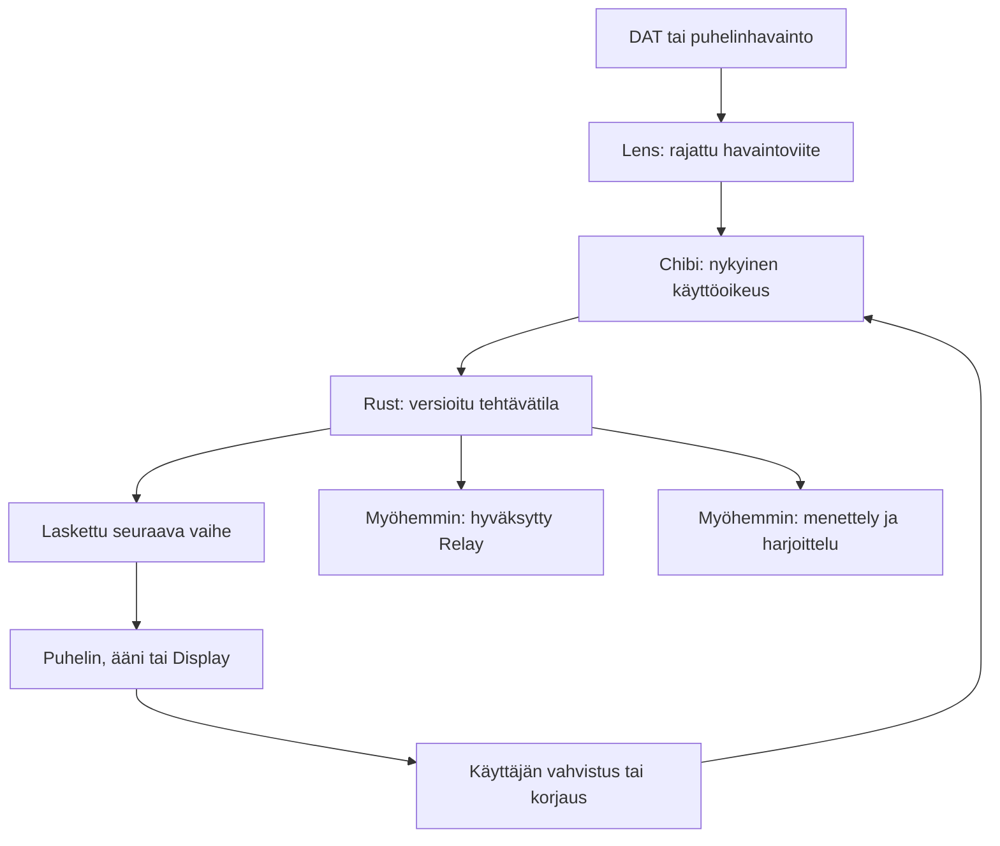

# Chibi Continuity — kunnianhimoinen tavoite ja käynnistetty toteutus

**Päiväys:** 14.11.2026  
**Työ:** META-EXEC-20261114  
**Päätös:** Mikaelin pyyntö käynnistää toteutus workereilla ja MCP-avulla.  
**Lähteet:** Junction `98d5a524d61e431ca36acd62b268ede343fc7fe2`, Chibi `a39f7d3957c16cc2db8a8af4fbd4bd8184dd4aea`.  
**Jatkuvuus:** [olemassa oleva suunnitelma ja tutkimus](CHIBI_RESUME_IMPLEMENTATION_PLAN_20261114.md), [yhteinen työrekisteri, issue 80](https://github.com/SalesSquad/junction-pets/issues/80#issuecomment-6872905280).

Tämä on toteutuksen uusi ohjaava suunnitelma. Aiemman suunnitelman laite-, lähde- ja havaintorajat säilyvät. Tämän dokumentin tavoitteet ovat tavoitetasoja; toteutunut näyttö kirjataan erikseen [työtilannekuvaan](meta-execution/execution.json).

## Ensimmäinen toimitettu toteutusnäyttö

- **[Chibi PR122](https://github.com/SalesSquad/chibi/pull/122), `a17785fd…`:** oikea Rust-domain ja export; `cargo test -p chibi-domain --locked --test meta_resume` käänsi todellisen craten ja läpäisi 3 testiä. Ajo tehtiin olemassa olevalla valtuutetulla MacBook Pron Rust 1.98.1 -ympäristöllä offline-tilassa, koska nykyisessä pilvityötilassa ei ole Rust-työkaluketjua. [Lähdekohtainen kuitti](meta-execution/h1-verification.json).
- **[Junction PR108](https://github.com/SalesSquad/junction-pets/pull/108), `01065ebc…`:** ajettava synteettinen selainprototyyppi, samaan tilakoneeseen sidotut paikalliset kontrollit ja rajattu WebMCP-sovitin. Yksi Node-skenaario läpäisi koko keskeytys–jatko–korjauspolun. Chromium estyi ennen sivun latausta ympäristön socket-oikeuteen; visuaalista selain-/Display-kelpuutusta ei ole. [Tarkka todiste](https://github.com/SalesSquad/junction-pets/blob/01065ebcffb74ebbb801f126ae8b46dba15b3a80/apps/meta-resume-web/verification.json).
- **Metan dokumentaatio-MCP:** oikea yhteys ja kaksi onnistunutta hakua; apurit ja lähdeviitteet on liitetty tähän toimitukseen.
- **Jatkuvuus:** olemassa olevan Product Factoryn ohje päivitettiin, tuntiaikataulu ja integraattori säilyivät. Ensimmäisten workerien rajatut toimeksiannot päättyivät lähdetoimitukseen; seuraavat tehtävät ovat nimettyjä jonotöitä, eivät piilossa jatkuvia prosesseja.

## 1. Erittäin kunnianhimoinen tavoite

**Rakennamme Chibistä fyysisen työn jatkuvuuden avustajan: sama tehtävä, muisti ja kumppani seuraavat ihmistä laseista puhelimeen, keskeytyksen yli, toiselle ihmiselle ja myöhemmin AR/VR-harjoitteluun.**

Käyttäjä voi sanoa: ”Auta minua saamaan tämä valmiiksi.” Chibi ymmärtää rajatun tavoitteen, muistaa käyttäjän vahvistaman etenemisen, poimii olennaisen havainnon, kysyy epäselvän kohdan ja näyttää seuraavan hyödyllisen teon. Kun työ keskeytyy tai ympäristö muuttuu, jatko perustuu tehtävän nykyiseen tilaan. Kun työ luovutetaan toiselle, vastaanottaja saa tarpeellisen tehtäväkontekstin oman hyväksyntänsä jälkeen.

**90 päivän tavoite:** kolme kokonaan toimivaa työnkulkua, 30 vapaaehtoista pilottikäyttäjää ja vähintään 300 todellista käyttöepisodia; keskeytyksestä jatkaminen vähintään 35 % nopeammin ja unohtuneet vaiheet vähintään 50 % harvemmin kuin saman käyttäjän puhelinmuistilistalla. Nämä ovat tutkimussuunnitelman tavoitteita, eivät saatuja tuloksia tai luvattuja rekrytointeja. Ennen mittausta lukitaan vertailu, tehtävät, virheluokat ja otanta.

**12 kuukauden suunta:** tuhannen viikoittaisen käyttäjän tuote, 50 versionoitua ja käyttäjien hyväksymää menettelyä sekä sama yksityinen tehtävätila kolmessa käyttömuodossa: puhelin, tuettu lasikokemus ja erikseen kelpuutettu XR-harjoittelu. Tämä on strateginen tavoite. Henkilöstöä, maksullisia palveluja tai laitehankintoja ei ole tässä varattu.

Kunnianhimo syntyy yhtenäisen kokemuksen laadusta. Jokaisessa vaiheessa pitää voida osoittaa, että ihminen sai oikean työn valmiiksi pienemmällä muistikuormalla. Pelkkä kamerakuva, puhuva hahmo tai suuri agenttimäärä ei vielä täytä tavoitetta.

## 2. Tuote kasvaa yhdestä ehjästä kokemuksesta

| Kerros | Käyttäjälle näkyvä hyöty | Riippuvuus |
| --- | --- | --- |
| **Lens** | ”Mitä tämä havainto kertoo juuri tästä tehtävästä?” | Nykyinen havaintoydin sekä todellinen kaappausadapteri. |
| **Resume** | ”Mihin jäin ja mikä on seuraava oikea vaihe?” | Vahvistettu tehtävätila, korjaukset ja keskeytys. |
| **Familiar** | ”Mikä muuttui edellisen vahvistetun tilanteen jälkeen?” | Ajallisesti rajatut havainnot ja ristiriitojen käsittely. |
| **Relay** | ”Voiko toinen ihminen jatkaa tästä?” | Vastaanottajan hyväksymä, rajattu ja peruttava tehtäväluovutus. |
| **Teach** | ”Muuta tämä onnistunut työ tarkastettavaksi ohjeeksi.” | Menettelyn luonnostelu, tekijän tarkastus ja versiointi. |
| **Practice** | ”Harjoittele samaa tehtävää ennen oikeaa tekemistä.” | Sama menettelymalli ja erikseen toteutettu XR-esitys. |

Ensimmäinen toteutettava tapaus on kolmen välineen kameralaukku. Käyttäjä vahvistaa kameran ja mikrofonin, keskeyttää työn, kohtaa samannäköisen välineen ja palaa pakkaamiseen. Chibi säilyttää kaksi vahvistusta ja ehdottaa kolmatta vaihetta. Vanha kuva, samannäköinen kohde tai mallin arvaus ei merkitse vaihetta tehdyksi. Yhteinen ensimmäinen skenaario hylkää vanhan havainnon ja lookaliken ilman revision muutosta, ja jatkaa revision 3 kohdalta revision 4:ään tyhjällä todistejoukolla. Erillinen oikean kohteen tapaus osoittaa, ettei hyväksyttykään havainto ole käyttäjän vahvistus.

Seuraavat kaksi tehtäväperhettä valitaan ensimmäisistä havainnoista: esimerkiksi työpisteen valmistelu ja harrastusvälineiden tarkistus. Lääkitys, teollinen turvatoimi tai muu vakavia seurauksia sisältävä työ ei ole tämän pilotin lähtötilanne.

## 3. Todellinen lähtötilanne ja uudelleenkäyttö

| Olemassa oleva lähde | Käyttö tässä kokonaisuudessa | Näytön raja |
| --- | --- | --- |
| Junction `services/meta-spatial/` | Havainto, historiallinen löytö, ehdokkaan verifiointi ja host-portit. | Host-injektoitu ydin; ei yksityistä tehtävämuistia tai laitekelpuutusta. |
| [Junction PR73](https://github.com/SalesSquad/junction-pets/pull/73) | SwiftUI/Swift-ydin ja Apple-sovittimen perusta. | Aiempi lähde-/Swift-näyttö ei osoita lasien ajoa. |
| [Junction PR75](https://github.com/SalesSquad/junction-pets/pull/75) | DAT 1.0.1, MockDeviceKit, Vision OCR ja säilytetyt simulaattoribuildit. | Build onnistui; SDK-frame/OCR-integraatioajosta ei vielä hyväksyttyä tulosta. |
| Chibin domain, runtime, memory ja store | Adoption-scope, nykyinen host-päätös, salattu tallennus ja revision-malli. | Uusi Resume-domain aloitetaan nyt; pysyvää tehtäväpalvelua ei vielä ole. |
| Nykyinen dispatch-ledger ja koerekisteri | Myöhempi työnjatko, idempotenssi ja ajon todisteet. | Niiden olemassaolo ei aktivoi hostia tai vastaanottajaa. |
| [Tuotetyökalut PR64](https://github.com/SalesSquad/junction-pets/pull/64) | Tuotteen metadata, käynnistysohjeet ja luovutus käytetään soveltuvin osin uudelleen. | Uutta kilpailevaa portfoliohallintaa ei rakenneta. |
| [Numeric-malli PR70](https://github.com/SalesSquad/junction-pets/pull/70) | Erillinen havaintotutkimus, jos todellinen kameravirhe sitä myöhemmin perustelee. | Synteettinen false-candidate-ongelma säilyy; malli ei ole Resume-polun riippuvuus. |

Chibin `pet_collaboration` on pois käytöstä oleva admission-sauma. Se ei ole valmis HTTP/MCP-reitti, malliagentti tai valtuus siirtää käyttäjän tietoja. Uusi tehtäväpalvelu sidotaan nykyisiin hostin identiteetti-, policy- ja tallennusrajoihin omana rajattuna muutoksenaan.

## 4. Arkkitehtuuri, joka kantaa seuraaviin vaiheisiin



Kuva esittää tavoiterakenteen; nuoli ei todista valmista yhteyttä. Rust-domainissa on deterministinen tehtävätilan muutos. Malli voi ehdottaa tulkintaa ja seuraavaa askelta. UI esittää käyttäjän vahvistuksen, havainnon ja ehdotuksen eri asioina. Pysyvä yksityinen totuus kuuluu Chibille; selainprototyypin synteettinen tila ei ole toinen tuotantomuisti.

### Yhteinen komento v1

```json
{
  "schemaVersion": 1,
  "taskId": "00000000-0000-4000-8000-000000000100",
  "commandId": "00000000-0000-4000-8000-000000000601",
  "expectedRevision": 0,
  "operation": "confirmStep",
  "payload": {"stepId": "00000000-0000-4000-8000-000000000201"}
}
```

Ensimmäiset operaatiot ovat `confirmStep`, `interrupt`, `observe`, `resume`, `correctStep` ja `revokeEvidence`. `observe` kuljettaa vain `evidenceId`-viitteen; host ratkaisee havainnon todellisen alkuperän, session, kaappaussukupolven ja tuoreuden. Asiakkaan antama tenant-kenttä tai suostumuslippu ei ole valtuus.

Komennon sama tunniste ja sisältö eivät tee muutosta kahdesti. Muutettu sisältö samalla tunnisteella on konflikti. Vastauksessa erotetaan komennon alkuperäinen sovellettu revision ja nyt laskettu näkymä, jotta uusinta ei palauta peruttua havaintoa uudeksi ehdotukseksi. Revision-konfliktissa käyttöliittymä hakee nykyisen tilan ja pyytää tarpeellisen uuden vahvistuksen.

Hostin pysyvyysvaiheessa komento, revision-muutos ja idempotenssikuitti kirjoitetaan samaan transaktioon. Kaappaus- ja suostumussukupolvi tarkistetaan myös ennen myöhempää lukua. Offline-jonossa epäselvä ulkoinen vaikutus selvitetään ennen uusintaa. Ensimmäinen domain-slice ei vielä toteuta tätä tietokanta- tai verkkopolkuja.

## 5. MCP on nyt mukana kahdessa eri tarkoituksessa

**Kehittäjien dokumentaatio-MCP on otettu käyttöön ja kokeiltu oikeasti.** Virallinen päätepiste on `https://mcp.developer.meta.com/wearables`. Palvelin vastasi nimellä Meta Wearables MCP Server 1.0.0, protokollalla 2025-11-25. `initialize`, `tools/list` ja molemmat `search_dat_docs` / `search_webapps_docs` -haut onnistuivat. Anonyymi haku ei vaatinut uusia tunnuksia. [Käyttöohje ja rajatut apurit](meta-execution/mcp/README.md), [todellinen kuitti](meta-execution/mcp/meta_mcp_receipt_20261114.json).

Apuri liittää dokumentaatio-MCP:n yksittäiseen olemassa olevaan Codex-kutsuun. Natiivit Chibi-workerit käyttävät tarvittaessa suoraa lukevan haun apuria; Chibin kielto käynnistää sisäkkäisiä CLI-agenttikampanjoita säilyy. Globaaleja tiliasetuksia tai uusia taustapalveluja ei tarvita.

**Tuotteen WebMCP on erillinen käyttöliittymän sovitus.** `document.modelContext` voi tarjota tuetulla alustalla rajattuja toimintoja samaan tilakoneeseen. Nappien ja äänipyynnön pitää päätyä samaan revision-/validointipolkuun. Prototyypissä lukeminen ja ehdottaminen ovat mahdollisia; tehtävän valmistuminen tarvitsee näkyvän käyttäjän vahvistuksen. UI toimii myös ilman WebMCP:tä. Yksityinen Chibi-hostin MCP-rajapinta ei ole tämän dokumentaatioyhteyden seurauksena käytössä.

API-päätökset tarkistetaan alustasta ja versiosta: yleinen iOS-haku palautti myös Android-viitteen. DAT 1.0.1:n pinnattu Swift-rajapinta on tarkempi lähde kuin yleinen hakutulos. SDK:ssa oleva Display-mock-API, selaimen Display-simulaattori ja fyysinen Display-laite kelpuutetaan erikseen.

## 6. Toteutuslinjat ja työnjako

| Linja | Nyt käynnistetty vastuu | Ensimmäinen valmis tulos | Seuraava riippuvuus |
| --- | --- | --- | --- |
| **H1 Tehtävämuisti** | Natiivi `gpt-6.1-sol`-worker; Chibin kaksi rajattua domain-tiedostoa. | Rust-tilasiirtymät ja keskeytys–jatko-skenaario. | Integraattorin export, sitten tallennus ja host-reitti. |
| **U1 Kokemus** | Yksi Junction Meta -kirjoittaja; `apps/meta-resume-web/**`. | Käytettävä, rehellisesti synteettinen puhelin/Display-kokemus. | Yhteisen komennon ja nykyisen snapshotin sovitus. |
| **A1 Kaappaus** | Olemassa olevan PR75:n jatko; lähteet ja säilytetty build tarkistettu. | Yksi todellinen DATIntegrationTests-ajo vanhoilla build-tuotteilla. | Nyt estynyt: kaikkien kolmen Macin levytila alle simulaattoriajon rajan. |
| **M1 MCP** | Dokumentaatio-MCP:n toteutus ja oikeat haut valmiit. | Rajattu Python-asiakas, Codex-asetus ja todiste. | Käytetään työn ohessa, tarkistetaan haun alusta/versio. |
| **I1 Integraatio** | Koordinaattori: yhteinen sopimus, export, suunnitelma ja PR-luovutus. | Yhteensopivat ensimmäiset lähdeslicet ja todellinen työtilanne. | Nykyinen Portfolio PR Recovery omistaa integraation päähaaraan. |
| **H2/P1/R1** | Jono: pysyvä host, oikeiden episodien arviointi, Relay/Familiar. | Yksi uusi todennettava kyky kerrallaan. | Ei vielä käynnissä oleviksi ilmoitettuja workereita. |

Työnjako aloitettiin kahdella lähde-/MCP-workerilla. Niiden jälkeen käynnistettiin kaksi lähdekoodia tuottavaa linjaa ja erillinen Apple-ajon jatkoselvitys. Yksi Junction Meta -kirjoittaja säilyy kerrallaan; Apple-selvitys ei muokkaa samaa lähdealuetta rinnakkain. Chibi-kirjoittaja toimii eri repositoriossa. Integraattori omistaa yhteiset sopimukset, exportit ja tämän toimituksen dokumentit.

Tämä ei ole uusi jatkuvasti pyörivä agenttiparvi. Olemassa oleva Product Factory jatkaa rajattuja tehtäviä julkaistujen lähde- ja omistajuustietojen perusteella. Jokaisella seuraavalla ajolla tarkistetaan nykyinen HEAD, elossa oleva työ ja seuraava oikea riippuvuus.

## 7. Vaiheet ja valmistumisen määritelmä

| Vaihe | Toimitus | Valmis, kun |
| --- | --- | --- |
| **Nyt: ensimmäinen pystysuora lähdeslice** | Domain, käytettävä synteettinen UI, yhteinen komento ja MCP-apu. | Käyttäjä voi vahvistaa, keskeyttää, jatkaa ja korjata; vanha havainto ei tee vaihetta valmiiksi. Lähteet ja PR:t ovat olemassa. |
| **Seuraavat 48 tuntia: yhdistäminen** | Ohut adapteri UI:n ja hostin välille; A1:n yksi ajo, jos resurssiehto täyttyy. | Yhteensopiva komento/snapshot; aidon adapterin ja mockin ero näkyy; hostin puuttuva valmius estää aidon kytkennän. |
| **Viikot 1–2: oikea tehtäväepisodi** | DAT/puhelimen todellinen havainto, yksityinen pysyvä tehtävä, reconnect ja unohtaminen. | Yksi katkeamaton havainto → tehtävä → vahvistus → keskeytys → jatko -ketju oikeassa ympäristössä. |
| **Viikot 3–6: pieni pilotti** | 8–12 vapaaehtoisen käyttäjän rajattu vertailu, vähintään 50 episodia. | Käyttöhyöty, virhetilanteet, latenssi, vahvistusten määrä ja keskeytyskuorma on mitattu. |
| **Päivät 45–90: kolme työnkulkua** | Familiarin merkityksellinen muutos, hyväksytty Relay ja 30 käyttäjän pilotin laajennus. | 300 episodia ja edellä lukitut hyötytavoitteet arvioitu. Tavoitteesta jääminen näkyy päätöksessä. |
| **Kuukaudet 4–6: ohjeen tekeminen** | Hyväksytystä episodista versionoitu menettely; sama ohje eri tilanteissa. | Tekijä tarkastaa luonnoksen, muutoshistoria ja epävarmat kohdat näkyvät, uusi käyttäjä onnistuu. |
| **Kuukaudet 6–12: XR ja laajempi jakelu** | Menettelyn harjoitteluesitys ja erillinen tuettu laitepolku. | Harjoittelun siirtyminen oikean työn osaamiseksi on mitattu; jokainen alusta kelpuutettu erikseen. |

Aikataulu on tavoitejärjestys, ei kalenterilupaus kolmen osittaisen integraation päälle. Tallennuksen ja host-admissionin puuttuminen käsitellään oikeana toteutustyönä. Laitteen puuttuminen ei pysäytä domainia tai puhelinpolkua; lasien lisäarvon väite odottaa oikeaa vertailua.

### Junctionin erillinen toimitusportti

Nykyinen submission-omistaja kokoaa rajatun kameralaukkutarinan toimivasta prototyypistä, lyhyestä esityksestä ja deckistä. Esitys näyttää keskeytyksen, epävarman havainnon, oikean jatkon ja käyttäjän vahvistuksen; samalla siinä kerrotaan tarkasti, onko syöte synteettinen, toistettu vai oikea laitekuva. Tuotteen 90 päivän visio ja tämänhetkinen toteutus esitetään eri kohtina. Julkaisu, ilmoittautuminen tai lähetys ei tapahdu tämän lähdekooditoimituksen sivuvaikutuksena. Nykyistä submission-linjaa ei monisteta, eikä tapahtumadeadline saa muuttaa mock-näyttöä laiteväitteeksi.

## 8. Ajatellaan monta askelta pidemmälle

**Ajallinen ymmärrys:** Familiar tarvitsee kahden kuvan vertailua pidemmän mallin: mikä oli käyttäjän vahvistama tavoitetila, mitä nähtiin myöhemmin, mikä puuttuu näkyvistä ja mikä on aidosti ristiriidassa. ”En nähnyt” ei tarkoita ”ei ole”. Tähän tarvitaan havaintojen kattavuus ja riippuvuudet heti datamalliin, vaikka ensimmäinen UI näyttäisi vain yhden kortin.

**Ohjeiden syntyminen tekemisestä:** Teach muuttaa hyväksytyt episodit tarkastettavaksi menettelyksi. Järjestelmä kerää perustelut, vaihtoehdot ja palautusvaiheet. Ohjeen tekijä hyväksyy sen ennen jakelua. Käyttäjän yksityinen raakavideo ei muutu automaattisesti jaettavaksi oppimateriaaliksi.

**Usean tehtävän koordinointi:** jos akun lataus estää seuraavan askeleen, Chibi voi tarjota saman tavoitteen riippumattoman valmisteluvaiheen. Tämä vaatii tehtävien välisiä riippuvuuksia, käytettävissä olevien resurssien tilaa ja käyttäjän valitsemaa prioriteettia. Ennen sitä yksi tehtävä pitää osata varmasti jatkaa.

**Asiantuntija oikeaan kohtaan:** yksi rajattu ongelma voi tarvita NVIDIA-/Rokoko-/muun companionin osaamista. Delegointi kantaa tehtävän revision, rajatun aineiston, pyydetyn kyvykkyyden ja vanhenemisen. Tuloksesta tulee ehdotus samaan tehtävään. Kaikkien agenttien jatkuva kutsuminen kasvattaisi viivettä, kustannusta ja ristiriitaisia muistioita.

**Ihmisten välinen jatkuvuus:** Relay siirtää keskeneräisen tehtävän, vahvistetut vaiheet, olennaiset varoitukset ja seuraavan askeleen. Vastaanottaja hyväksyy luovutuksen. Tehtävän toimivalta, yksityiset keskustelut ja kaikki alkuperäinen media eivät siirry oletuksena. Peruutus ja samaan aikaan tehdyt korjaukset ratkaistaan tehtävärevision kautta.

**Harjoittelu ennen toimintaa:** Practice käyttää samaa menettelyä VR-harjoituksessa tai tuetun AR-laitteen opastuksessa. Nykyisen pienen Display-näkymän päälle ei luvata maailmaan lukittua 6DoF-hahmoa. Puhelimen ARKit-pose ei ole lasien pose. XR-adapteri saa omat koordinaatistonsa, seurannan katkeamisen käsittelyn ja hyötymittauksen.

**Tuleva fyysinen delegointi:** myöhempi robotti- tai laiteohjaus voidaan kytkeä yksittäiseksi hyväksytyksi kyvykkyydeksi. Se tarvitsee oman action-, stop-, turvallisuus- ja ympäristön kelpuutuksen. Nykyinen havainto- tai tehtävämuisti ei anna oikeutta liikuttaa laitetta.

## 9. Mittarit ja päätökset, joilla vältetään loputon demo

Ensimmäisen tuotteen päämittari on aika keskeytyksen päättymisestä seuraavaan oikeaan tekoon. Sitä täydentävät unohtuneet vaiheet, väärän kohteen ehdotukset, tarpeettomat vahvistukset, onnistunut palautuminen yhteyden katketessa ja käyttäjän oma kokemus muistikuormasta. Mittaus erottaa synteettisen, toistetun ja aidon episodin.

Paikallisen kuittauksen tavoite on alle 0,5 sekuntia ja yksinkertaisen hyödyllisen ehdotuksen tavoite alle 2 sekuntia. Kameran käyttö, verkkoon siirtyvä aineisto ja mallikutsut mitataan per episodi. Jatkuva kuvaaminen ei ole lähtöoletus: kaappaus sidotaan käyttäjän pyyntöön tai hyväksyttyyn tehtäväkohtaan.

**Päätöspiste 1:** jos ensimmäisissä episodeissa käyttäjä joutuu opettamaan järjestelmää enemmän kuin saa apua, vähennetään automatiikkaa ja kavennetaan tehtävää. **Päätöspiste 2:** jos lasit eivät tuo puhelimeen verrattuna lisäarvoa, jatketaan toimivaa puhelin/ääni-kokemusta ja muutetaan lasien käyttötapausta. **Päätöspiste 3:** oma malli aloitetaan vasta, kun todellisten kuvien virheet osoittavat rajatun tarpeen; nykyisen numeric-mallin lisääminen ei korvaa tätä näyttöä.

Käyttäjäpalautteen perusteella valitaan Relay tai Familiar seuraavaksi laajaksi kyvyksi. Molempien täysi toteutus yhtä aikaa ennen toimivaa Resumea hajottaisi oppimisen.

## 10. Käynnistyksen konkreettiset esteet ja jatko

1. **Codex Cloud -tilalistaus:** CLI näytti kirjautuneen tilan mutta palvelin vastasi HTTP 401, ”Could not parse your authentication token”. Historiallista Meta-ympäristö-ID:tä ei merkitä käynnissä olevaksi. Toteutus jatkuu nykyisessä toimivassa pilvityötilassa, GitHub-yhteydellä ja natiiveilla subscription-workereilla. Normaali saman tilin istunnon päivitys on mahdollinen erillinen jatko, ei syy siirtää tunnuksia.
2. **Apple/DAT-ajo:** MBP 17,20 GiB, Air 11,32 GiB ja Mini 15,24 GiB vapaata tarkistushetkellä; simulaattorin preflight vaatii 25 GiB. Säilytetty checkout, SDK ja build-tuotteet tarkistettiin. Uusi ajo odottaa sopivaa Apple-kapasiteettia. Muiden tiedostoja tai välimuisteja ei poistettu tämän työn vuoksi.
3. **Aito Chibi-host:** uusi domain ei vielä ole pysyvä API. Seuraava H2-slice toteuttaa tenant-scoped tallennuksen, transaktion ja nykyisen session/admissionin sovituksen. Toimivuutta ei päätellä pelkästä koodirajapinnasta.
4. **Fyysiset lasit ja pilotti:** dokumentaatioyhteys tai mock ei todista paritettua laitetta. Oikea laite, käyttäjän suostumus ja arviointiepisodi ovat laitepolun seuraavat riippuvuudet. Rekrytointia tai yhteydenottoja ulkopuolisiin ei ole tehty.

Seuraava toteuttaja lukee [execution.json](meta-execution/execution.json), nykyiset PR-headit ja issue 80:n viimeiset omistajuusmerkinnät. Kun ensimmäiset lähdeslicet ovat valmiit, ne luovutetaan nykyiselle integraattorille ja Product Factory jatkaa ensimmäistä toteutuskelpoista riippuvuutta. Suunnitelmarivi, jobin nimi tai ajastus eivät yksin ole käynnissä olevan workerin todiste.

## Lähteet

- [Meta-haaste M342](https://hackjunction.app/participate/45/challenges/342) ja [14.11. lähdekatalogi](https://github.com/SalesSquad/junction-pets/blob/98d5a524d61e431ca36acd62b268ede343fc7fe2/docs/challenge-research/current-source-catalog.json): arjen first-person-hyöty, saavutettavuus ja toimiva prototyyppi; audio/web/DAT ovat hyväksytyt toteutusmuodot.
- [Meta source entrypoint](https://github.com/SalesSquad/junction-pets/blob/98d5a524d61e431ca36acd62b268ede343fc7fe2/docs/META_START_HERE.md), [Lens-ydin](https://github.com/SalesSquad/junction-pets/tree/98d5a524d61e431ca36acd62b268ede343fc7fe2/services/meta-spatial), nykyiset PR73/75 ja alkuperäisen suunnitelman lähdehakemisto.
- [Virallinen DAT iOS README, lähdepinni](https://github.com/meta/meta-wearables-dat-ios/blob/bbae597cd1c748cd29b9375a1624a8d75b1c9e14/README.md), [SDK 1.0.1](https://github.com/meta/meta-wearables-dat-ios/tree/0bd369298eef6a980ad0bdb6c8a5502f2c02a08c), [Web Apps -työkalut](https://github.com/meta/meta-wearables-webapp/tree/fbf132997d036548ce090761a8bd4cf0afbda52a).
- [Chibin lähdesopimus](https://github.com/SalesSquad/chibi/blob/a39f7d3957c16cc2db8a8af4fbd4bd8184dd4aea/docs/adr/0008-source-contract.md), [domain](https://github.com/SalesSquad/chibi/tree/a39f7d3957c16cc2db8a8af4fbd4bd8184dd4aea/crates/chibi-domain), [host-integraation nykyiset rajat](https://github.com/SalesSquad/chibi/blob/a39f7d3957c16cc2db8a8af4fbd4bd8184dd4aea/docs/integration/junction-event-host.md).
- [Todellinen MCP-kuitti](meta-execution/mcp/meta_mcp_receipt_20261114.json), [lähdekohtainen työtilanne](meta-execution/execution.json) ja [käynnistettyjen vastuiden merkintä](https://github.com/SalesSquad/junction-pets/issues/80#issuecomment-6872905280).
