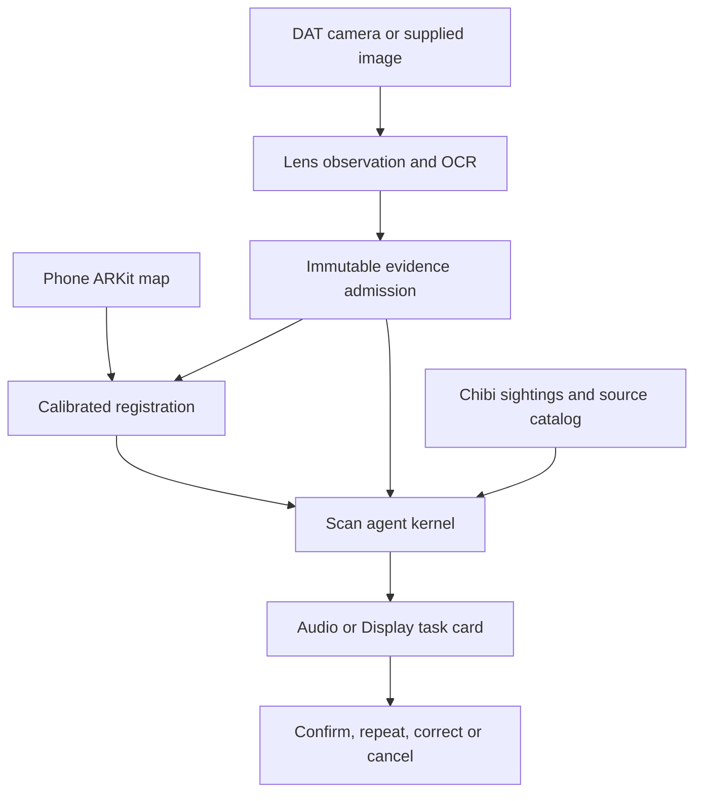

> Integration note: this design record and its research sources are available in main. The executable `services/meta-spatial/` slice remains in [PR #60](https://github.com/SalesSquad/junction-pets/pull/60) until separately integrated; recorded tests qualify that source only.

# Chibi Lens: scalable Meta scanning and spatial-memory lane

Work ID: `junction.meta.scan-lane-v1`. Source base:
`61f10a44cfd833e02fa64462dfc7429046fff210`. Task branch:
`codex/junction-meta-scan-lane-20261113`. Developer identity: `junction-dev-meta`.
This is an explicit design record and first portable source increment.

## Product decision

**“Remember where I left it — and verify I found the right thing.”**

Scan a room or important object, preserve source-backed sightings, retrieve the
most relevant last observation, and confirm the current physical item. Our
advantage is correctable object memory and verification across time, supported
by the owner's sources and task agents. Describing a scene alone is insufficient.

Hero demonstration: a uniquely tagged keys pouch is observed first on a desk,
then on a shelf. A request retrieves both historical sightings and prioritizes
the newer one. A new scan verifies the tag or returns ambiguity. Removing it and
rescanning returns not-observed, while preserving the history. A registered phone
AR view may highlight a shelf; audio remains sufficient to use the task.

The first fixture has three concepts: object identity, named zone, and observed
event. The real native path will add actual images/labels, then calibrated map
registration. Product discovery should measure whether a user finds and verifies
an item faster, and whether uncertainty is understood.

## Ownership and boundaries

| Layer | Owner / reuse | Current increment |
| --- | --- | --- |
| Glasses transport/audio | Native Meta DAT adapter | Interface and admission expectations; native integration remains next. |
| Local image processing | Taimi Lens Vision/OCR patterns | Observation envelope and bounded entities; no copied private app code. |
| Phone world model | Lens/Reality Twin ARKit | Separate map/reference inputs; no fabricated head pose. |
| Registration | Calibrated marker/map localization | Host verification port; no local pose issuer. |
| Scan task logic | This `services/meta-spatial/` lane | Executable inspect/find/verify kernel with strict contracts. |
| Accounts, grants and memory | Private Chibi host, Rust/Cedar | Required host ports; no second identity/memory server. |
| Durable jobs | Existing dispatch ledger / host | Source-bound interface; local capacity control is not a distributed scheduler. |
| Model | Authorized bounded provider adapter | Exactly one ID-selection call for inspection; deterministic retrieval/verification flow. |

The diagram describes intended host integration. This increment actually runs
the portable kernel and fake-port demonstration. It starts no background service.

## Contracts and trust

An admitted observation binds tenant, session generation, source-device kind,
frame digest/dimensions, host receipt time and perception entities. The host
resolves the immutable record and validates active capture provenance. A caller
or model cannot create a trusted Meta-camera observation by setting a boolean.

Semantic candidates and spatial registration remain separate. Registration
requires map ID, pose reference, calibration revision, expiry and host acceptance.
Unregistered observations remain useful for OCR, identity candidates and spoken
guidance. A phone pose never becomes the glasses pose because the devices pair.

The request digest includes trusted actor/tenant/source context and exact input.
The host's durable reservation scopes idempotency by tenant+actor+request ID and
rejects different input under the same key. The kernel additionally checks the
returned replay envelope and rechecks capture/registration policy. Real host
storage must authenticate cached result integrity and fence distributed workers.

The proposal model selects only a visible entity and an approved procedure ID/
digest. The instruction text comes from the immutable source record, with a
separate original-document digest. The model cannot invent instructions, pose,
identity proofs, effects or new tools. All outputs retain `actionAuthorized:false`.

## Scale without an oversized scene prompt

Use a two-rate pipeline: device/local processing produces candidate keyframes;
the server admits a bounded observation only when the user/task needs it. Drop
late frames, superseded session generations and redundant images before model
work. Store media through the host's scoped encrypted evidence store; pass opaque
references and digests to workers.

The implemented kernel has bounded concurrent admission (default 4), queued work
(32), lookup pages (2), items per page (8), page bytes (16KiB), visible entities
(32), source-text sizes and a single model proposal. The 10,002-object fixture
exercises a 16-result retrieval window; it is a bounded-payload proof, not a
production database/throughput benchmark.

For the real host, use tenant-scoped indexes on target/object, zone and descending
observed-time plus stable ID. Use snapshot-bound opaque cursors, never fetch all
room objects into a prompt. Return `hasMore` to refine a query. Preserve sightings
and append corrections rather than silently overwriting history. Raw camera media,
semantic evidence, metric maps and rendered Gaussian splats have distinct stores
and lifecycles.

Existing PostgreSQL dispatch leases/fencing handle multiple workers and restart;
the kernel's semaphore limits one host instance only. Shard work by authenticated
tenant/session and use provider-wide budget/rate admission in the host. Measure
queue time, capture-to-answer latency, aborted work, model calls per successful
task, retrieval misses and rework before widening capacity. Never equate more
workers with a better product.

## AR roadmap

1. **Useful perception:** real DAT frame → local OCR → candidate/grounded step →
   routed speech. No metric registration claim is needed.
2. **Memory integration:** host appends verified sightings/corrections with explicit
   capture/retention controls; retrieve timestamped history by object and zone.
3. **Phone AR setup:** use native ARKit world/image/object tracking for the phone's
   map and selected objects. Query hardware capability; ordinary iPhone 14 has no
   LiDAR scanner.
4. **Registered glasses sightings:** calibrate the actual DAT stream, observe a
   known-size marker and estimate its pose separately from the phone. Compose only
   transforms with explicit common frame/unit/convention and validated timing.
5. **Continuous localization:** a research lane using map matches or validated
   visual-inertial inputs. Orientation alone does not establish metric position.

Meta's documentation says intrinsics must be calibrated from stream frames; the
SDK does not supply that calibration. Apple ARSession operates with the phone's
built-in camera/motion; no external Meta-frame world-tracking input was found.
iOS 27 `.referenceobject` assets offer phone-based object detection/tracking, and
Vision accepts external buffers for perception. These are different capabilities.

## Discord-grounded build path

The authenticated `#meta` channel was read through its start-of-channel marker
and latest loaded messages. At 20:05 EET on 13 November, Meta staff linked the
official developer portal, Display Simulator, DAT and Web Apps guides and all
three public GitHub repositories. These confirm the native iOS path for scanning
and optional Display web UI. The connector preview remains a later distribution
opportunity rather than a dependency of this challenge increment.

The hardware channel's lending instructions require a request at
`https://2026.hackjunction.com/hardware`, a table number, up to two prioritized
items, and physical pickup with the responsible person's ID at Arduino Hardware
Lab. No request, reset, pairing change or external message was submitted. Actual
stock and a pair assigned to us remain unverified.

Exact message links and source URLs are in
[`evidence/meta-discord-20261113.json`](evidence/meta-discord-20261113.json).
The logged-in Discord session is a read route; it is not a live Discord API feed.

## Engineering continuation

| Next bounded lane | Owned paths / acceptance |
| --- | --- |
| Native capture/audio | New Meta adapter in the approved native host; one real initiated frame, session-generation checks, route verification, cancellation and phone-image fallback. |
| Host memory | Existing Chibi/Lens domain; append/correct sightings, account isolation, retention and immutable source receipts. No memory logic copied into a public package. |
| Registration | Independent calibrated marker module; measured error, stale-pose loss and reacquisition; phone/head independence test. |
| Display | Small card surface using official toolkit; D-pad/voice parity and validated `document.modelContext` actions; no camera assumption for a web app. |
| Evaluation | Real moved/ambiguous/removed objects, actual capture/model latency, accessibility and a blinded task-completion comparison. |

Root integrator owns this service, cross-module contracts, shared manifests and
PR delivery. Other companion packages and existing PRs 54–58 remain untouched.
Future writers resume from the actual PR HEAD, source record and checks; a desired
cloud environment or a task manifest does not mean a worker is running.

## Qualification

Portable tests exercise source integrity, bounded catalogs, idempotent fake-host
replay, tenant denial, cancellation/revocation, stale frames, identity/source
binding and semantic-versus-spatial separation. The demo is labelled synthetic.
Native DAT compilation, physical glasses, real model responses, persistent Chibi
memory, PostgreSQL integration, hardware accuracy and product usability remain
separate acceptance gates. No merge, deploy, permission change or spending occurs
in this source increment.

Primary technical sources:

- https://github.com/meta/meta-wearables-dat-ios (release 1.0.1 `0bd369298eef6a980ad0bdb6c8a5502f2c02a08c`)
- https://github.com/meta/meta-wearables-dat-android
- https://github.com/meta/meta-wearables-webapp (`fbf132997d036548ce090761a8bd4cf0afbda52a`)
- https://wearables.developer.meta.com/docs/develop/dat/camera-stream-processing
- https://wearables.developer.meta.com/docs/develop/dat/microphones-and-speakers
- https://developer.apple.com/documentation/arkit/arsession.md
- https://developer.apple.com/documentation/arkit/arreferenceobject.md
- https://developer.apple.com/documentation/vision/vnimagerequesthandler.md
- https://docs.opencv.org/4.x/d5/d1f/calib3d_solvePnP.html

Reuse source pins: Lens `4cd3cfab836f9d1a1d0f066f97985a4d94106f97`, Reality Twin
`53d8346d93fbbb735c62284d0f6d86ec1ce5b6a9`, Chibi
`c775341193507f745d6fbd30e320a3b5cf8a4ef3`. These are source references, not fresh
native/device validation in this lane.
