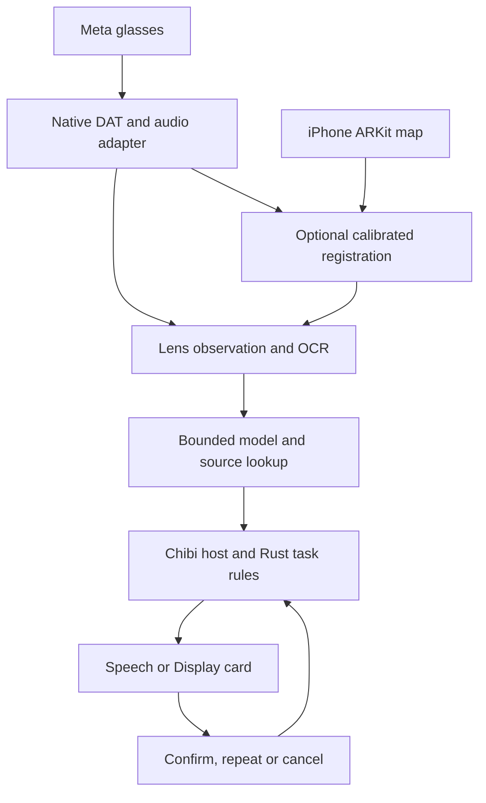

# Meta glasses + ARKit: technical research and product architecture

Research date: **13 November 2026, Europe/Helsinki**. Prepared for Mikael / Junction.

## Decision

Build a useful first-person assistant through **Meta Device Access Toolkit → an iPhone capture adapter → our existing Lens perception/evidence components → Chibi task execution → spoken guidance**. Use ARKit to establish the phone's spatial map and recognize selected objects. Introduce glasses-to-map localization as a separately measured capability.

The strongest starting experience is **Read & Do**: look at a household object or document, identify the relevant label/control, receive one grounded instruction, and confirm, repeat or cancel it. A spatial-memory extension can remember an observed object's last verified location. The industrial field coach, Sailor and Golfer become later verticals using the same observation contract.

This is a research/design deliverable. Five specialist workers examined hardware, SDK interfaces, ARKit, spatial research and our repositories. Public SDK interfaces and sample code were inspected; Meta's anonymous documentation MCP was actually initialized and queried. No physical glasses, firmware capture, native build, provider inference or glasses/ARKit integration was tested during this research.

## 1. What changed since the initial Meta companion audit

The earlier monorepo finding remains correct: `junction-pets` Meta v0.1.2 supplies guidance and a synthetic permission example. Its focused tests passed in the previous audit; those tests do not exercise Meta hardware.

The ecosystem is substantially broader than that package describes:

- Meta offers native mobile DAT integration, standalone Display web apps and an assistant connector preview.
- Current September 2026 announcements include Ray-Ban Meta Gen 3 and a camera-free Audio model. Gen1/Gen2-only inventories are incomplete.
- Display web apps support assistant-callable WebMCP actions.
- iOS 27 supports Create ML `.referenceobject` assets for native object tracking.
- Our private **Taimi Lens** source already contains ARKit capture, OCR, spatial evidence and Rust-backed memory/actions. This is a stronger starting point than building a new spatial stack in the Meta companion directory.

The exact headset/firmware available at Junction, account release-channel eligibility and physical sensor access remain to be verified. The recorded challenge emphasizes everyday first-person usefulness, accessibility, implementation and impact. The written authenticated Challenges button was disabled during the preceding browser check; the video is the direct brief available in this conversation.

Sources: [Meta build routes](https://developers.meta.com/wearables/faq/), [2026 glasses announcement](https://about.fb.com/news/2026/09/introducing-ray-ban-meta-audio-glasses-new-styles-plus-muse/), [Apple object tracking](https://developer.apple.com/documentation/arkit/arworldtrackingconfiguration/trackingobjects.md).

## 2. Hardware: choose the capabilities of the actual pair

The figures below are manufacturer specifications and advertised mixed-use battery ceilings. They are not measurements of continuous third-party camera streaming, usable API bandwidth or our application performance.

| Family | Relevant distinction | Consequence for our product |
| --- | --- | --- |
| Ray-Ban Meta Gen 1 | Camera/audio; no display; 12MP camera, five microphones, roughly four-hour mixed-use claim | Camera/audio baseline; answers need speech or phone UI. |
| Ray-Ban Meta Gen 2 | Camera/audio; 12MP and consumer 3K capture; up to eight hours | Useful supported baseline; inspect negotiated DAT stream independently. |
| Ray-Ban Meta Gen 3 | September 2026; 12MP/3K, six microphones, action button, up to nine hours | New model must be included in device discovery; test actual SDK and input exposure. |
| Ray-Ban Meta Audio | Camera-free, 43g, six microphones, up to twelve hours | Can provide speech/audio interaction, but cannot be the vision source. |
| Oakley Meta HSTN | Camera/audio; advertised 100° camera FOV and IPX4 | Outdoor/sports variant; weather and activity conditions affect perception. |
| Oakley Meta Vanguard | Centered camera; advertised 122° FOV, IP67 and up to nine hours | Interesting future Sailor/Golfer endpoint; characterize its own image geometry. |
| Meta-branded Glasses | Additional EssilorLuxottica camera/audio families launched in 2026 | Match exact SKU to supported capabilities rather than inferring from brand. |
| Meta Ray-Ban Display | Right-eye 600×600 color display, approximately 20° display FOV; camera/audio | Add brief cards and explicit selection; ordinary camera glasses have no such display. |
| Meta Neural Band | EMG-based input and haptics | Use supported gestures; consumer app access does not imply raw EMG access. |
| Orion | Optical see-through research prototype with richer spatial sensing | Research reference, with no assumed Junction/retail access. |
| Quest 3 / 3S | Horizon OS, 6DoF and stereo passthrough; different depth hardware | Separate MR application and SDK route. |
| Meta VR Glasses | Announced for spring 2027, separate compute puck/Horizon OS route | Future platform; no present hardware assumption. |
| Project Aria Gen 2 | Research sensor platform with calibrated cameras/IMUs and perception tooling | Valuable research reference and datasets; separate hardware and access program. |

Display's right-eye panel is a compact heads-up surface. Public DAT display layout APIs do not establish a world-locked hologram/occlusion system. A display, an orientation sensor and a camera together do not automatically provide metric 6DoF tracking.

The current DAT FAQ explicitly names Gen1/Gen2, Display and Oakley models, and says new SKUs are supported as available. Newer product announcements therefore require device-specific verification. Finnish Meta AI availability, Display retail availability and Developer Center access are separate questions. No purchase or region/account approval was performed.

Primary hardware sources:

- [Ray-Ban product comparison](https://www.ray-ban.com/usa/l/discover-ray-ban-meta-ai-glasses)
- [Gen2 announcement](https://about.fb.com/news/2025/09/ray-ban-meta-gen-2-better-battery-life-video-capture/)
- [Gen3 and Audio announcement](https://about.fb.com/news/2026/09/introducing-ray-ban-meta-audio-glasses-new-styles-plus-muse/)
- [Oakley HSTN](https://www.oakley.com/en-de/product/888392682888) and [Vanguard](https://www.oakley.com/en-eu/product/888392690401)
- [Meta-branded collection](https://about.fb.com/news/2026/06/meta-essilorluxottica-partner-launch-meta-glasses/)
- [Display specifications](https://www.ray-ban.com/usa/l/discover-meta-ray-ban-display)
- [Orion](https://www.meta.com/emerging-tech/orion/), [Horizon device comparison](https://developers.meta.com/vr/essentials/compare-devices/), [future VR Glasses](https://developers.meta.com/vr/discover/meta-vr-glasses/)

## 3. Three development routes

| Route | Code runs in | Best use for us | Principal dependency |
| --- | --- | --- | --- |
| Device Access Toolkit | Native iOS/Android app coordinating supported glasses | Our own camera processing, audio, task flow and phone spatial context | Pairing, app registration, permissions, session lifecycle and real device |
| Display Web App | Browser on Meta Ray-Ban Display | Small Chibi interface, task cards, voice-operated tools | Display hardware, HTTPS and supported browser APIs |
| Meta AI Connector | Our service API called by Meta AI | Account-linked Chibi/Taimi services reached through the assistant | Selected-wave preview admission; public distribution unavailable at research time |

The native route is the best fit for our camera + ARKit plan. Meta's public documentation search explicitly states that camera access and captured microphone audio belong to DAT. Web apps receive dictated text or assistant tool calls; a web app alone cannot implement our raw glasses-camera pipeline.

A Display web app can still be a valuable, independently testable companion UI. A connector is a later distribution route, without providing ownership of Meta AI's internal perception or unrestricted raw sensors.

Sources: [current FAQ](https://developers.meta.com/wearables/faq/), [Web Apps](https://developers.meta.com/wearables/web-apps/), [Meta AI Connectors](https://dev.meta.ai/products/connectors). The last page documents REST API onboarding, OAuth account linking and preview selection. No application was submitted.

## 4. Public SDK reverse engineering

This inspection reconstructed the published API and lifecycle boundaries. It did not disassemble firmware or establish an undocumented wire protocol.

### Source pins

| Source | Inspected revision |
| --- | --- |
| iOS samples/docs main | `bbae597cd1c748cd29b9375a1624a8d75b1c9e14` |
| iOS SDK tag/release 1.0.1 | `0bd369298eef6a980ad0bdb6c8a5502f2c02a08c` |
| Android samples/docs main | `f4371bc9f90249d51eb07d7f8a61e8d829294f16` |
| Display Web Apps main | `fbf132997d036548ce090761a8bd4cf0afbda52a` |

The iOS package contains eight binary XCFramework targets: Core, Camera, Display, Inputs, Motion, Speech, MockDevice and MockDeviceTestClient. Public Swift interfaces and sample apps expose useful contracts, while implementation internals remain proprietary. Main sample source and release binary revisions are distinct and must be pinned separately.

The reconstructed lifecycle is: configure the Wearables client; register the application through Meta AI; obtain the appropriate device permissions; select a device; create a DeviceSession; attach supported capabilities; consume cancellable streams/listeners; stop and tear down cleanly. Application registration does not grant camera/microphone permission.

The sample configuration includes BLE, Bluetooth Classic external-accessory protocol `com.meta.ar.wearable`, and local-network/high-bandwidth declarations. This identifies requirements of the integration. It is insufficient to reproduce the authenticated transport or bypass pairing.

### API inventory

| Feature | Public surface inspected | Engineering boundary |
| --- | --- | --- |
| Camera streaming | Camera capability, stream and frame publisher | App receives media and owns interpretation. |
| Stream media | Raw frames or HEVC; CMSampleBuffer on iOS | Handle decode, orientation, crop and backpressure. |
| Stream configuration | Published options include 720×1280, 504×896, 360×640 and requested 2/7/15/24/30fps | Requested settings can differ from delivered settings. |
| In-stream photo | Photo request and data publisher | A rejected request is a failure, not an image. |
| Standalone high-quality photo | Camera photo capability | Experimental feature boundary. |
| Camera-associated PCM audio | Timestamped audio frames | Experimental/development-beta restriction. |
| Speech | On-device transcript capability | Experimental; permission and device support still matter. |
| Motion | Timestamp, optional acceleration/gyro/magnetometer/quaternion | Experimental; orientation is not a position tracker. |
| Inputs | Device input events | Experimental; inspect which source/action the actual hardware reports. |
| Voice invocation | App-invocation stream | Experimental app launch surface, not arbitrary control of Meta AI. |
| Display | UI-tree/card/image/video-style APIs | Query display support; no spatial hologram contract found. |

The changelog labels several features experimental and excludes their production publication. The FAQ describes DAT 1.0 as stable, while repository prose still contains preview terminology. Feature-level release notes and the actually resolved package should govern implementation decisions.

Primary inspected files:

- [iOS Package.swift](https://github.com/meta/meta-wearables-dat-ios/blob/0bd369298eef6a980ad0bdb6c8a5502f2c02a08c/Package.swift)
- [Camera Swift interface](https://github.com/meta/meta-wearables-dat-ios/blob/0bd369298eef6a980ad0bdb6c8a5502f2c02a08c/MWDATCamera.xcframework/ios-arm64/MWDATCamera.framework/Modules/MWDATCamera.swiftmodule/arm64-apple-ios.swiftinterface)
- [Motion Swift interface](https://github.com/meta/meta-wearables-dat-ios/blob/0bd369298eef6a980ad0bdb6c8a5502f2c02a08c/MWDATMotion.xcframework/ios-arm64/MWDATMotion.framework/Modules/MWDATMotion.swiftmodule/arm64-apple-ios.swiftinterface)
- [Changelog](https://github.com/meta/meta-wearables-dat-ios/blob/bbae597cd1c748cd29b9375a1624a8d75b1c9e14/CHANGELOG.md)
- [CameraAccess sample](https://github.com/meta/meta-wearables-dat-ios/tree/bbae597cd1c748cd29b9375a1624a8d75b1c9e14/samples/CameraAccess)
- [Android SDK repository](https://github.com/meta/meta-wearables-dat-android/tree/f4371bc9f90249d51eb07d7f8a61e8d829294f16)

The DAT root license points to Meta Developer Terms. The Web Apps toolkit has a BSD license. Inspect the exact file/package license before incorporating sample code or distributing dependencies; an example repository is not automatically MIT.

## 5. Two concrete traps: calibration and audio routing

### Calibration

The inspected Camera Swift interface exposes a sample buffer and an image conversion helper; Motion exposes inertial readings and orientation but no translation. Root then verified the stronger statement through Meta's live documentation MCP: the SDK does not report intrinsic camera calibration, and developers should calibrate delivered stream frames.

Meta's camera-processing guidance distinguishes stream geometry from standalone photographs, notes stabilization effects, recommends a pinhole starting model and per-model calibration, and describes scaling focal/principal-point values when delivered width changes. Our design must additionally verify crop/aspect changes, residual distortion and actual stream configuration before reusing a calibration profile.

A sample buffer could contain implementation-specific attachments; these were not physically inspected. Any such attachments require device testing and must not silently become a guaranteed cross-device API contract.

Source: [camera stream processing](https://wearables.developer.meta.com/docs/develop/dat/camera-stream-processing), retrieved through the public documentation MCP, DAT docs version v1.0. The ordinary web page itself presented a login wall.

### Audio routing

Meta's current iOS guidance supports ordinary audio/speech playback through Bluetooth A2DP and bidirectional microphone/audio through HFP. Verify the actual route rather than assuming an utterance reaches the glasses. HFP must settle before starting the DAT camera stream; route changes can alter format and stop the audio engine. HFP voice playback and A2DP media playback have different quality/usage characteristics.

For an initial prototype, standard iPhone speech synthesis plus verified glasses playback provides a path that does not depend on experimental camera PCM or DAT Speech. Real microphone capture, interruption, echo and route recovery remain separate tests.

Source: [microphones and speakers](https://wearables.developer.meta.com/docs/develop/dat/microphones-and-speakers), retrieved through Meta's documentation MCP, v1.0.

## 6. What ARKit can contribute

| Capability | Useful integration | Required distinction |
| --- | --- | --- |
| World tracking, planes and raycasts | Phone-based scan and map setup | Pose belongs to the phone camera. |
| ARWorldMap | Save anchors/map state and relocalize a later phone session | A saved map is not automatic localization of incoming glasses frames. |
| Image anchors | Register a known image with physical dimensions into the phone world | Glasses require their own image detection/pose estimate. |
| iOS 27 object references | Train selected assets and detect/track them with the phone | Does not provide ARKit processing of an arbitrary external stream. |
| LiDAR scene reconstruction | Optional metric geometry/mesh capture on supported hardware | Query support; a regular iPhone 14 lacks a LiDAR scanner. |
| RoomPlan | Optional supported-device room setup and USD/USDZ export | Uses phone/tablet camera and LiDAR. |
| Apple Vision/Core ML | OCR, object/marker analysis of DAT buffers/images | Image analysis is separate from ARKit world tracking. |
| RealityKit | Phone AR view or controlled virtual-camera twin visualization | Rendering does not supply glasses tracking or display transport. |

Apple's public iOS ARSession documentation describes the device's built-in camera and motion hardware. No public external-Meta-frame injection API was found in this research. `CameraFrameProvider` receives camera streams on visionOS; it is not an iOS external-camera input API. Vision does accept external image, pixel-buffer and sample-buffer inputs, making it the appropriate entry point for glasses-image perception.

Sources: [ARSession](https://developer.apple.com/documentation/arkit/arsession.md), [CameraFrameProvider](https://developer.apple.com/documentation/arkit/cameraframeprovider.md), [Vision handler](https://developer.apple.com/documentation/vision/vnimagerequesthandler.md), [LiDAR support](https://developer.apple.com/documentation/arkit/arworldtrackingconfiguration/supportsscenereconstruction%28_%3A%29), [RoomPlan](https://developer.apple.com/augmented-reality/roomplan/).

### New iOS 27 opportunity

Apple documents Create ML-trained `.referenceobject` assets usable on iOS 27 and reusable from visionOS. Stationary detection can use `detectionObjects`; moving/handheld tracking uses `trackingObjects`, with increased power cost. Old `.arobject` and new `.referenceobject` assets cannot be mixed in one session. Check `ARObjectAnchor.isTracked` because retained anchors can outlive active tracking.

Proposed application: selected equipment or household USDZ assets → trained reference → phone recognition/registration → shared semantic asset ID → grounded Chibi instruction. Training quality, actual device support and transfer to our chosen objects require evaluation.

Sources: [ARReferenceObject](https://developer.apple.com/documentation/arkit/arreferenceobject.md), [trackingObjects](https://developer.apple.com/documentation/arkit/arworldtrackingconfiguration/trackingobjects.md), [ARObjectAnchor](https://developer.apple.com/documentation/arkit/arobjectanchor.md).

## 7. Connecting the two coordinate systems correctly

**The head and phone move independently.** Pairing them does not create a fixed spatial transform. A phone in a pocket is also not a useful active camera-based mapper.

Use three explicit tiers:

| Tier | Result | Dependency |
| --- | --- | --- |
| A: observation assistant | Read/recognize a glasses image and give a grounded response | Camera and perception; no metric position claim. |
| B: registered observation | Place a glasses-camera observation into the phone map | Calibrated camera plus a known marker or verified map correspondences. |
| C: continuous spatial assistance | Maintain glasses pose between observations | Independent validated localization/VIO or a supported provider pose; research work. |

For tier B, put a known-size AprilTag/ArUco board in the scene. Register that board in the phone's world, then estimate the glasses camera's pose from the board's corners in the glasses image using calibrated intrinsics.

Define `T_A←B` as a transform mapping coordinates from B into A, with a shared canonical marker frame M:

`T_world←glassesCamera = T_world←M × inverse(T_glassesCamera←M)`

Convert phone-anchor and computer-vision coordinate conventions into the same M convention before composing. Image orientation/crop, unit scale and handedness also need explicit handling. Never raycast a glasses pixel with the phone's camera matrix or attach the phone pose to the glasses frame.

Proposed acceptance conditions: positive depth; adequate marker pixel coverage; reprojection residual within a measured threshold; plausible multi-frame solution; correct corner ordering; bounded age; explicit loss/reacquisition behavior. Planar pose ambiguity and rolling shutter must be tested. When registration is stale, preserve semantic guidance while dropping precise spatial assertions.

After marker proof, a separate research lane can explore retrieval + local-feature matching + 2D–3D pose against a reference map. Full inertial fusion additionally needs validated clock mapping, camera/IMU geometry and sampling behavior. An optional quaternion does not establish that pipeline.

Primary references: [AprilTag](https://github.com/AprilRobotics/apriltag), [OpenCV PnP](https://docs.opencv.org/4.x/d5/d1f/calib3d_solvePnP.html), [Hierarchical Localization](https://github.com/cvg/Hierarchical-Localization), [ORB-SLAM3](https://github.com/UZ-SLAMLab/ORB_SLAM3).

## 8. Display, WebMCP and connector opportunities

The Display web-app path is particularly relevant to our existing web-agent work. Its public toolkit specifies a 600×600 additive viewport, directional focus, pinch/Enter selection, a 30Hz panel and a startup target below 300KB/fewer than 15 requests. Use short task cards, a conspicuous current step and repeat/cancel controls.

The pinned WebMCP implementation uses **`document.modelContext`**. Its skill documentation describes per-device enablement, a ten-second assistant tool deadline and callback-side argument validation. Tool registration may throw or return void depending on the build. This needs a platform adapter and capability detection; blindly copying another browser's `navigator.modelContext` integration is unsafe.

Proposed tools are `get_current_task`, `repeat_step`, `propose_next_step` and `cancel_task`. The same underlying state must drive D-pad and voice. Use a small immediate acknowledgement for work that cannot finish within the tool deadline, with a separately authorized job/status flow. Idempotency and cancellation belong to the host, not the assistant's wording.

The development documentation MCP, in-page WebMCP and remote Meta AI Connectors serve different purposes:

| Mechanism | Purpose |
| --- | --- |
| Wearables documentation MCP | Coding agents search official developer guidance. |
| In-page WebMCP | Meta AI invokes tools exposed by the currently open Display web app. |
| Meta AI Connector | An account-linked service API is exposed through Meta AI's preview platform. |

Meta has also announced Muse on glasses. Our differentiation should be source-grounded memory, domain workflows and auditable execution, rather than the mere presence of a general assistant.

Sources: [Web Apps toolkit](https://github.com/meta/meta-wearables-webapp/tree/fbf132997d036548ce090761a8bd4cf0afbda52a), [WebMCP skill](https://github.com/meta/meta-wearables-webapp/blob/fbf132997d036548ce090761a8bd4cf0afbda52a/plugins/meta-wearables-webapp/skills/ai-glasses-webapp-webmcp/SKILL.md), [agentic examples](https://github.com/meta/meta_glasses_webmcp), [connector preview](https://dev.meta.ai/products/connectors).

## 9. Research ecosystem: Aria and reconstruction

Project Aria Gen2 exposes a substantially richer research sensor package. Its factory calibration includes camera intrinsics/extrinsics and IMU parameters. Its Machine Perception Services process compatible Aria VRS recordings for research partners and produce trajectories, calibration and point clouds. These outputs cannot be assumed for retail DAT video.

Use Aria to learn coordinate/time conventions and evaluate spatial algorithms on annotated datasets. It is not a shortcut for unlocking consumer sensors or uploading arbitrary Ray-Ban footage to MPS.

Useful research assets:

| Resource | Research value |
| --- | --- |
| Aria Everyday Activities | Everyday spatial memory, shared context and retrieval. |
| Aria Digital Twin | Asset correspondence, object identity and spatial ground truth. |
| Ego4D / Ego-Exo4D | Egocentric task understanding, procedural steps and coaching. |
| Project Aria Tools | Calibration, recording formats, trajectory/time handling and evaluation. |
| Reading in the Wild | Reading-activity research; distinct from recognizing text. |

Each dataset has its own access and licensing conditions. The richer gaze/ground-truth/multiview channels are evaluation inputs, not sensors our consumer product automatically has.

Keep reconstruction artifact types separate:

| Artifact | What it provides |
| --- | --- |
| OCR/VLM observation | Semantic evidence and candidate interpretations. |
| SfM / sparse map | Camera/structure estimates; physical scale needs external information. |
| Dense reconstruction | Geometry dependent on views, calibration and coverage. |
| Gaussian splat | Appearance and novel-view rendering. |
| Metric mesh/occupancy | Explicit geometry for measured spatial queries. |
| BIM/asset graph | Versioned authored identities, relationships and properties. |

A convincing splat does not establish a navigable collision model or semantic inventory. A visual model can propose an asset match; source data and geometric checks establish whether it becomes a trusted spatial fact.

Sources: [Aria calibration](https://facebookresearch.github.io/projectaria_tools/gen2/technical-specs/device/calibration), [MPS](https://facebookresearch.github.io/projectaria_tools/gen2/ark/mps), [Aria Tools](https://github.com/facebookresearch/projectaria_tools), [AEA](https://facebookresearch.github.io/projectaria_tools/docs/open_datasets/aria_everyday_activities_dataset), [ADT](https://facebookresearch.github.io/projectaria_tools/docs/open_datasets/aria_digital_twin_dataset), [Ego-Exo4D](https://docs.ego-exo4d-data.org/), [Reading in the Wild](https://facebookresearch.github.io/projectaria_tools/docs/open_datasets/ritw), [COLMAP](https://colmap.github.io/tutorial.html), [Gaussian Splatting authors](https://github.com/graphdeco-inria/gaussian-splatting).

## 10. Reuse from our repositories

These are source observations, not new device/build qualification. Open draft PRs are separate from main and must be revalidated before integration.

| Repository / source pin | Relevant existing work | Remaining boundary |
| --- | --- | --- |
| `taimi-lens` main `4cd3cfab836f9d1a1d0f066f97985a4d94106f97` | Swift camera, Vision OCR, ARKit maps, evidence registration, Rust memory/actions | Phone input today; real glasses adapter and physical accuracy unproven. |
| `reality-twin` main `53d8346d93fbbb735c62284d0f6d86ec1ce5b6a9` | RGB/pose/intrinsics/depth/mesh capture with bounded queues | LiDAR path needs supported hardware and device proof. |
| `chibi` main `c775341193507f745d6fbd30e320a3b5cf8a4ef3` | SwiftUI/Rust boundary, identity/approval/adoption patterns | Host/provider activation remains a separate integration. |
| `junction-pets` main `61f10a44cfd833e02fa64462dfc7429046fff210` | Meta companion, consent example, Council/contracts | No glasses connection. |
| `junction-pets` PR56 `91137cb91ba8b70cf6aef4de6163e0c452bd20a0` | Callable tools, durable replay, recorded bounded model workflow | Open draft; no production glasses/host activation. |
| `junction-pets` PR57 `1383ae8dba2f17fe86f1b895bd7dfc4d3b814ecc` | TypeSafe/Luna/Anthropic provider pilots | Development observations; Gemini missing in checked stores. |
| `junction-pets` PR58 `b1e9fbc18df0a3afa683dd2d3a34d19c4c979e25` | Nemotron visual reasoning harness | No live NVIDIA response verified in that snapshot. |
| `valmethack` main `42376f9dbe0fbb1c6943430d8e420f17051c4143` | Catalog/evidence/point-membership and transform concepts | No automatic segmentation, safe navigation or live diagnosis established. |
| `valmet-truth-engine` main `516780353774297fd399c8be2aa9081aeedb55a4` | Extraction/contracts/offline industrial view | Asset mappings/telemetry in the inspected demo are synthetic. |

The highest-value files are Lens `SpatialCapture.swift`, `SpatialEvidence.swift`, `CameraCapture.swift`, `DocumentPerception.swift`, `DocumentObservation.swift`, `ProposalReview.swift`, and Rust `core/src/actions.rs` / `core/src/memory.rs`. Root independently inspected Lens spatial capture and confirmed phone AR frame timestamps, intrinsics, support checks, reference tracking and map/relocalization fields.

Lens is reusable research code, with meaningful qualification gaps: prior simulator/unsigned evidence is not physical-device accuracy proof; missing holdout evidence, a failed strict OS snapshot/image privacy target and unmeasured outbound traffic must remain visible. Reuse its registered/pending evidence boundary without inheriting unsupported product claims.

Private source links: [Lens spatial capture](https://github.com/SalesSquad/taimi-lens/blob/4cd3cfab836f9d1a1d0f066f97985a4d94106f97/Apple/Sources/TaimiLens/SpatialCapture.swift), [Lens evidence](https://github.com/SalesSquad/taimi-lens/blob/4cd3cfab836f9d1a1d0f066f97985a4d94106f97/Apple/Sources/TaimiLens/SpatialEvidence.swift), [Reality Twin capture](https://github.com/SalesSquad/reality-twin/blob/53d8346d93fbbb735c62284d0f6d86ec1ce5b6a9/Sources/RealityTwinCapture/CaptureController.swift), [Chibi native](https://github.com/SalesSquad/chibi/blob/c775341193507f745d6fbd30e320a3b5cf8a4ef3/mobile/apple/README.md), [PR56](https://github.com/SalesSquad/junction-pets/pull/56), [PR57](https://github.com/SalesSquad/junction-pets/pull/57), [PR58](https://github.com/SalesSquad/junction-pets/pull/58).

## 11. Proposed integration architecture

This is a proposed architecture. The arrows are interfaces to implement and verify, not live connections.

The native app owns device lifecycle and local preprocessing. Extract a small shared observation contract from the existing apps instead of copying several whole applications. The Chibi host owns user/account context, task authority and durable effects. Junction companion content remains a domain instruction/source pack.

Every observation should record: source device and session generation; capture timestamp and clock domain when known; receipt monotonic time; image dimensions/orientation/crop; image digest; calibration revision; registration state; optional map/pose reference with uncertainty and age; semantic candidates and evidence; model/tool/source revision; cancellation lineage.

Registration states should distinguish unregistered, pending, registered and stale. A paired DAT frame begins unregistered. A model answer cannot set registered merely by asserting confidence. The phone map and glasses capture must remain separate evidence origins.

Inference should be event-driven. Run local quality/OCR checks first; send a selected image/crop to a visual model only when needed. Reuse the Nemotron adapter after authenticating its real provider path. Use a bounded typed decision model for narrow choices where useful. Do not invoke every provider on every frame. Model selection, budget and latency become measured configuration.

The response should contain one actionable step, the evidence/source behind it and an uncertainty state. Repeat and slower guidance should be cheap local operations. Cancellation must fence capture, inference completion and speech so an old result cannot speak after the user stops.

## 12. Product choices and challenge fit

These comparisons are product judgments, not measured user-study scores.

| Experience | Challenge fit | Reuse | Main new risk | Recommendation |
| --- | --- | --- | --- | --- |
| Read & Do: label/control → verified next step | Strong everyday first-person purpose; accessible audio | Lens OCR, evidence and Chibi workflow | Real device/audio and grounding quality | First demonstration |
| Where did I leave it? | Strong spatial-memory story | Lens memory and optional map | Retrieval privacy, mistaken identities, stale location | Follow after basic perception |
| Industrial field coach | Strong domain differentiation | Valmet/Reality Twin | Asset truth, deployment access, operational risk | Later vertical or separate partner demo |
| Sailor/Golfer glance assistant | Personal relevance and outdoor utility | Existing pet workflows | Noise/weather, stale data and device support | Later bounded vertical |
| Whole pet marketplace on glasses | Broad distribution story | Chibi catalog | Too much UI and a diluted demonstration | Keep outside the first task |

The first demonstration should show a real capture, a useful answer, a confidence/grounding failure, repeat/cancel, and a phone fallback. ARKit should contribute a visible, honest capability such as phone-based object/map setup. If marker registration succeeds, demonstrate it explicitly rather than implying it from a floating card.

Design for users who cannot rely on a visual display, precise gestures, rapid reading or long spoken instructions. Offer controllable pace and interruption. Stored observations should be explicit and scoped; capture indicators and permission revocation remain part of the product behavior. Keep the initial workflow to verified observation/guidance and reversible task updates.

## 13. Next engineering wave proposal

This table assigns future scopes; it does not claim these engineering jobs were started by the research workers.

| Lane | Bounded ownership | Deliverable / decisive check |
| --- | --- | --- |
| Device bridge | New native Meta capture/audio adapter | Source-pinned package; mock lifecycle; one real initiated frame and routed reply. |
| Perception | Lens-compatible image/OCR/model interface | Correct buffer orientation; bounded queue; grounded result and low-confidence abstention. |
| Spatial registration | Separate calibration/marker module | Actual stream calibration, measured marker pose and loss/reacquisition behavior. |
| Task/UI | Chibi task state and optional Display client | Voice/D-pad parity, repeat/cancel, strict tool validation and deadlines. |
| Independent review | Read-only exact final source and evidence | Check geometry provenance, lifecycle, device/model receipts and demo claims. |

The integrator owns shared contracts, Rust/native bindings, manifests, exports and PR integration. Start the native lane on one verified Mac; portable image/geometry tests can run in an authorized cloud runner. Keep source on isolated task branches and recheck current PR ownership before touching the same paths. No new daemon, paid resource or production deployment is needed for the research itself.

Suggested sequence: phone-image fallback → mock DAT adapter → real camera/audio loop → native phone object/map setup → marker-gated registration → optional Display WebMCP → continuous localization research. A blocked geometry experiment should not prevent delivery of useful unregistered visual assistance.

## 14. Verification and open questions

| Gate | Measurement / failure case |
| --- | --- |
| Hardware identity | Exact SKU, firmware, app, SDK release, negotiated capabilities and supported account channel. |
| Media | Delivered dimensions/fps/encoding, crop changes, dropped frames, stale input and reconnect. |
| Audio | Actual output/input route, HFP-before-camera ordering, interruptions, route changes, repeat/cancel. |
| Lifecycle | Registration/permission denial, revoke, fold/doff, pause, terminal stop, backgrounding and thermal state. |
| Geometry identity | Move phone while head is still; move head while phone is still; poses must remain independent. |
| Calibration | Stream-specific intrinsics and residuals across distance, lighting, movement and resolution changes. |
| Registration | Marker loss, ambiguous pose, relocalization, moved object, changed room and expired transform. |
| ARKit objects | Actual iOS 27 reference training/tracking, isTracked loss, power/thermal load. |
| Performance | Capture-to-speech p50/p95 by stage, bytes/model calls per successful task, battery/temperature. |
| Accessibility | VoiceOver/large type, visual/audio alternatives, pace, confidence failures and cancellation. |
| Grounding | Correct source/asset, unsupported identity rejection, stale evidence and document-version mismatch. |
| Evidence | Exact source/model/device provenance; mock, recorded, live and synthetic runs kept distinct. |

No latency, accuracy, power or spatial-error target is reported as achieved. Thresholds should be selected from the task's required precision and actual calibration/holdout measurements.

Unresolved documentation differences include preview/stable wording, some product specification and OS minimum discrepancies, new-SKU compatibility, and mock Display support described differently across SDK material and FAQ. Pin source and test the exact device instead of combining the most favorable statements.

The principal present blocker for hardware qualification is the absence of a verified available pair and device/account test run in this task. The principal architectural gap is independent glasses-to-map registration. Neither prevents a phone-image or clearly labelled mock demonstration while the real hardware path is prepared.

## 15. Executed research evidence

- Five finite specialist research workers completed read-only scopes; no engineering dispatch or always-on process is claimed.
- Public iOS release Swift interfaces and sample/source revisions were inspected; proprietary implementation/firmware was not.
- Root cross-checked Apple ARSession, CameraFrameProvider, Vision and iOS 27 object references, current Meta routes, Display specifications and Aria calibration/MPS.
- Root directly initialized `https://mcp.developer.meta.com/wearables`: HTTP 200, server `Meta Wearables MCP Server` v1.0.0. Anonymous `tools/list` exposed `search_dat_docs` and `search_webapps_docs`.
- Four read-only searches returned HTTP 200: calibration (4 sections), audio (3), display layout (3), and WebMCP/camera boundaries (4). DAT search identified documentation version v1.0.
- No account token, Developer Center project inspection, registration, release, publishing, connector application or permission change was performed. The public documentation server is distinct from account access.

Hashes of the raw documentation response captures, retained as transient research evidence:

| Query | SHA-256 |
| --- | --- |
| Camera calibration | `bc2cd9dc222f5d8100f371ceb4149796c3ee8b05ae4b8f6f9573232601574023` |
| Audio routing | `4c6b6f46be198b474dfb7304bb964a0d2eca332e77e1e2e9760e135f08da2c82` |
| Display layout | `d4d99ee85d55a378e216687d22afc35fb82c2887af4f82ac4e08ce0724c9faf9` |
| WebMCP/camera boundary | `fd606b89b1a8f6bdac521f378262ad0656fa8ef8059fe95212a8ca5ed65d54a7` |

The hashes identify this research's captures; they are not provider signatures or permanent hosted logs. API/model token balances, dollar costs and hardware benchmark results remain unknown.
