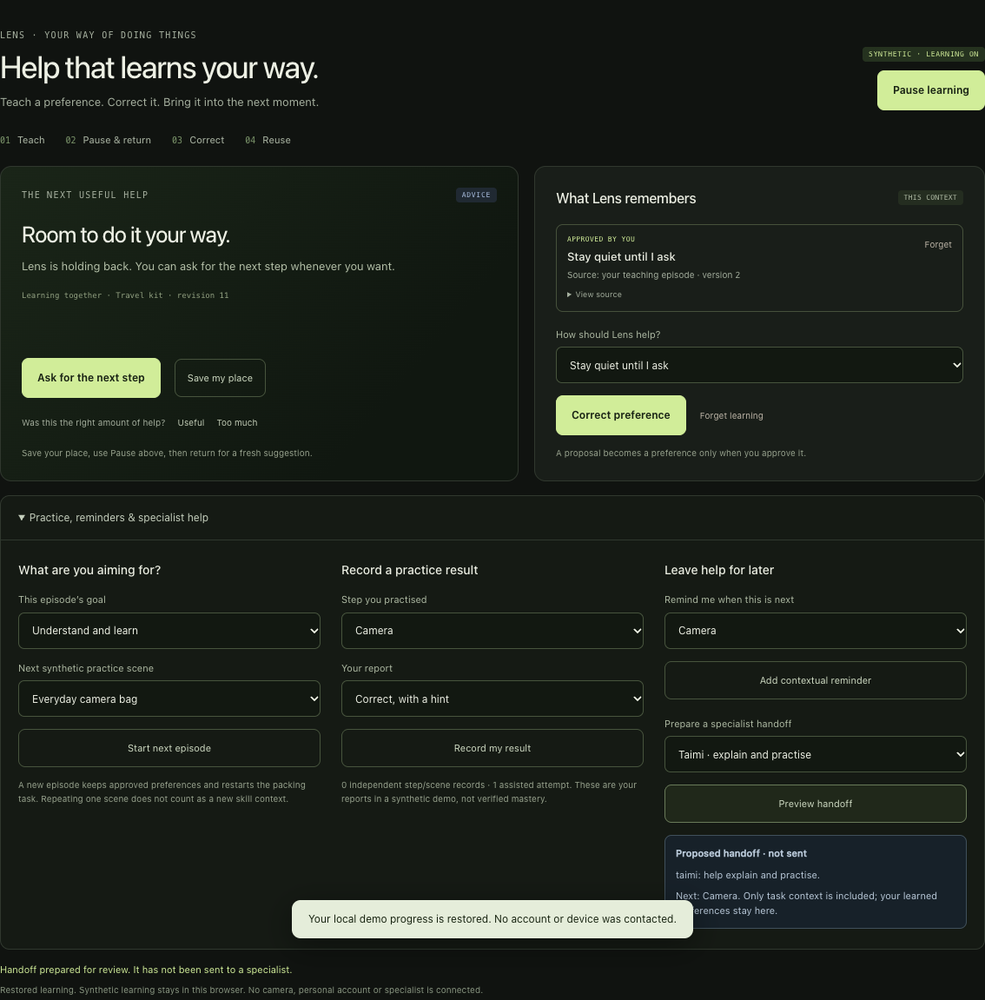

# Lens learning loop

Work: LENS-LEARNING-20261114. Source admission: Junction commit
`9e1915827fabff9836dac217ab69727e514acc49`.

## Design decision

Extend the existing Resume browser journey with an executable, explicitly
synthetic learning experience: teach a preference, pause/resume a task, correct
that preference, reuse it in a later episode, then forget it and its derived
state. Episodes, confirmed preferences, and user-attested learning outcomes stay
separate. Goals and feedback can change the suggested amount of help. Model
decisions are advisory and cannot confirm progress, consent or mastery.

The Junction implementation is a portable reference and developer simulation,
not the authenticated private Chibi memory store. Real identity, authorization,
encrypted persistence and consent remain in private Chibi. Existing Chibi and
Taimi sources are referenced, never copied into this repository. No raw video,
private conversation or real personal profile belongs in fixtures or receipts.

## Shared implementation contract

Browser core: `apps/meta-resume-web/learning-core.mjs`.
`createLearningSession({scope, now})` returns `dispatch(command, {actor})`,
`snapshot()`, `recommend(task, {requested})`, `admitDecision(decision, task)`,
`exportState()` and `handoff(recipient, task)`.
`restoreLearningSession(saved, {scope, now})` validates the full synthetic save.
Scope has exact keys tenantId, ownerId, contextId; fixture IDs are synthetic.
All commands have exact keys schema, commandId, expectedRevision, operation,
payload. Schema is `lens.learning-command/v1`; actor is supplied by the caller,
never accepted from command data. User commands alone can change consent,
confirm/correct/forget memory, feedback and learning outcomes.

Operations and exact payloads:
- `setConsent`: {enabled:boolean}
- `setGoal`: {goal:'finish'|'learn'}
- `startEpisode`: {episodeId:string, templateId:string}
- `proposeMemory`: {memoryId:string, style:'one_step'|'detailed'|'quiet'}
- `confirmMemory`: {memoryId:string}
- `correctMemory`: {memoryId:string, style:'one_step'|'detailed'|'quiet'}
- `forgetMemory`: {memoryId:string}
- `forgetAll`: {}
- `checkpoint`: {taskId:string, taskRevision:integer, nextStepId:string|null}
- `recordOutcome`: {stepId:string, correct:boolean, hints:integer}
- `recordFeedback`: {proposalId:string, value:'useful'|'distracting'}
- `setReminder`: {reminderId:string, stepId:string}
- `ackReminder`: {reminderId:string}

Task inputs have exact keys taskId, revision, status ('active', 'interrupted',
'completed'), nextStepId (string|null). Recommendations carry explicit
SYNTHETIC/advisory labels and bind scope, episode, learning revision, memory
epoch, task revision, and expiry. Reject stale results after any relevant user
change. A repeated assisted practice does not create independent mastery.

## Evaluation transport contract

`simulate.mjs` writes a suite with schema `lens.learning-evaluation-suite/v1`,
evidenceMode `SYNTHETIC`, source {baseCommit, files}, and cases. Each case has
{id, request, expected, domain}. `request` is the existing exact
`factory.decision-assist-request/v1` object; its source_sha256 equals SHA-256 of
its input UTF-8 bytes. `expected` maps question names to allowed choice values
(an array per question). It is NEVER sent to a provider. `domain` contains
separate deterministic observations for the local simulation report.

`evaluate.py` imports the verified pinned Factory decision adapter from an
external checkout. It must not copy private Factory sources or read keys for
offline runs. Offline injected transports test serialization/normalization and
are labelled simulated responses; actual Jev/Decisions runs require explicit
live selection and remain separate. Preserve refusals, malformed replies,
timeouts and unknown delivery without blind retries. Count actual calls and
tokens; unknown cost stays unknown. No provider output grants runtime authority.

## Acceptance

Run the bounded local simulation, provider-contract simulation, and one browser
journey covering teach → pause → resume → correct → next episode → forget.
Include wrong-scope restore, stale response, denied model mutation, assisted
practice, duplicate command and changed-goal cases. Run each real provider only
on the fixed synthetic suite through existing authorized credentials/budget.
These checks do not qualify physical glasses, production memory, actual
Taimi mastery, SAM inference or a live private Chibi host.

## Run the experience and simulations

From the Junction repository root, use the existing synthetic observation server:

~~~sh
node services/meta-spatial/observation-server.mjs --mode synthetic
~~~

Open http://127.0.0.1:8787 and choose Learn. Start learning, suggest and approve a
help preference, then use the original packing controls to pause and resume.
Correct the preference and start a new practice episode. Approved preferences
survive reload; Forget learning removes memory, outcome and derived reminder
state. Audit operations and hashed idempotency receipts carry no old preference
payloads. Learning consent is separate from the existing observation switch.

~~~sh
node services/lens-learning/simulate.mjs --output /tmp/lens-learning-results
python3 services/lens-learning/evaluate.py \
  /tmp/lens-learning-results/provider-suite.json \
  --factory-checkout /absolute/path/to/authorized/factory-source \
  --output /tmp/lens-learning-results/provider-offline-report.json
~~~

The external Factory source must match every module hash in provider-sources.json.
A clean Git checkout or a separately materialized, byte-verified private source
snapshot is supported. A snapshot reports executorCommit=null; it does not claim
a Git checkout. Private Factory code is not distributed with Junction.

The default provider run injects transport fixtures. It tests the actual existing
wire conversion, answer parser and journal. Its label comparisons are NOT model
accuracy. An actual bounded provider evaluation explicitly adds:

~~~sh
--live both --state-dir /absolute/path/to/owned/private-evaluation-state
~~~

Existing approved host credentials are read by Factory's own adapter. Never copy
keys into this repository or into the browser. Expected answers and domain
results remain outside provider payloads. A failed or uncertain attempt consumes
its recorded budget; retries require an understood outcome and distinct,
explicitly admitted work. A refusal or model disagreement remains in the report.

The single changed-path browser journey uses an already installed Playwright:

~~~sh
node services/lens-learning/browser-check.mjs /tmp/lens-learning-browser
~~~

Set CHROMIUM_PATH to an existing browser executable when necessary. The journey
starts and closes its own loopback synthetic server and isolated browser context.

## Existing components and integration boundary

| Component | Reused here | Remaining production work |
| --- | --- | --- |
| Resume | Original user-confirmed task state, checkpoint and browser experience | Actual authenticated host and device admission |
| Factory | Exact pinned Jev and OpenAI Decisions serialization, parsing, budget and key-reading implementation, imported externally | A production host chooses when permitted context may leave the device |
| Chibi memory | Preferences/routines, source provenance and lifecycle inform the interface; private source is not copied | Host-owned mapping and encrypted memory persistence |
| Taimi learning | Independent versus assisted practice remains distinct; repeated scene templates do not inflate diversity | Real verified learning events and FSRS/domain integration |
| SAM / NVIDIA | Existing optional observation panel remains available alongside learning | Actual model and physical capture evidence, independently qualified |

The demo supports a fixed synthetic camera-bag routine and explicit help
preferences. It does not infer an arbitrary new routine from video. Independent
practice means a synthetic user report, never a measured physical skill.
Handoffs contain only goal/current task context and are prepared for review;
they do not dispatch a pet or share a personal profile.

## Evidence

See evidence/ for source-bound domain simulations, browser results, independent
review and separate provider results. The initial transport-source omission
and the repaired run are separate records. Neither offline fixtures nor a failed
local initialization is counted as a successful provider response.

| Observation | Result | What it establishes |
| --- | --- | --- |
| Domain simulation | 8 synthetic cases, 11 checks passed | Consent, correction, stale-result and task-state boundaries in the reference core |
| One real browser journey | 7 checks, no page errors, 7.906 s | The synthetic browser flow on the recorded Chromium runtime |
| TypeSafe Jev | 7 actual responses; 20 of 21 question labels match | Bounded model behavior on the declared synthetic text inputs |
| OpenAI Decisions | 7 actual responses; 18 of 21 question labels match | Bounded model behavior on the same declared inputs |

The successful live batch took 12.852287 seconds. It is not an end-user latency
benchmark. Its seven cases have three related questions each, and the labels
have not been calibrated against real user benefit. These scores cannot rank
the models or establish production accuracy. In particular, a `stay_silent`
answer where the fixture expects `ask_one_question` needs product judgment;
the original expected labels and mismatches are preserved.

The live run remains bound to its recorded harness hash. A subsequent review
hardened imported-module path admission; its separate offline checks are recorded
without relabeling the earlier live run as execution of the changed harness.
Both providers use synthetic text/state, not camera footage. The browser does
not call either provider and does not train model weights.

The next meaningful comparison is a frozen, independently reviewed set of new
episodes, run against the deterministic core, core plus Jev, and core plus
Decisions. Measure whole-task success, avoidable interruptions, correction
burden, and time to resume. A real-device experiment must separately measure
capture-to-feedback latency and learning transfer. Adding similar fixtures alone
does not supply that evidence.

