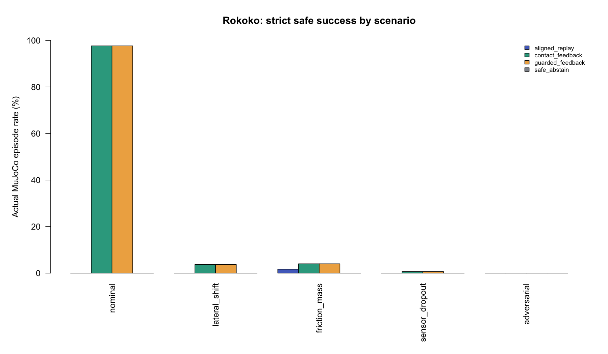
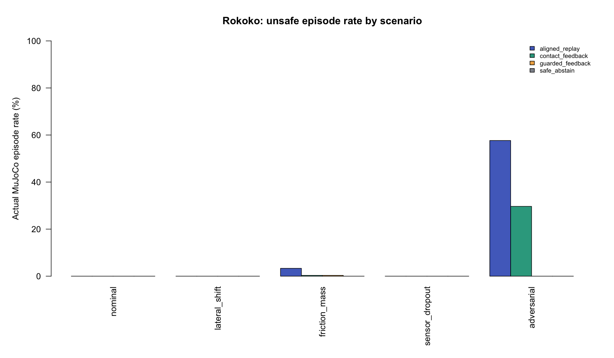

# MotionBridge Forge MegaSim — actual MuJoCo physics + R evaluation

**Work:** J26-ROKOKO-MEGASIM-20261114 · **Challenge:** Rokoko M326
**Parent source:** stacked M1 #110 → M2 #122 → M3 #123.
**Frozen physics producer source commit:** ec5dce6d21cd64b4d7d647bce124fb6b5c2543b0.
**Simulation label:** SYNTHETIC_MUJOCO. **Data label:** UNVERIFIED_REPLAY.
**Maturity:** simulation/research, NOT trained RL, SDK, physical device or sponsor verification.

## Actual completed qualification: 14 November 2026

The dedicated MacBook Pro CPU executed three independently hash-bound shards.
Each contains 500 independent scenario seeds × four actual MuJoCo rollouts.
Thus 1,500 different worlds, 6,000 physical-solver episodes and **18,000,000
MuJoCo steps** (0.002-second integration step; 3,000 per episode).
These are real simulated contacts/collisions/masses/frictions, not R-generated
toy outcome samples. No commercial GPU, model inference or provider calls were
used for the physics. Runtime/cost details are in each shard's manifest.

| Actual paired policy | Strict safe / 1,500 | Unsafe episodes | Damaged objects |
| --- | ---: | ---: | ---: |
| Geometry-corrected, initially aligned replay | 5 | 183 | 70 |
| Repeated noisy-object observation + feedback | 318 | 90 | 8 |
| Same feedback with conservative mapped-obstacle abstention | 318 | 1 | 1 |
| Always abstain / no pusher movement | 0 | 0 | 0 |

**R 4.6.2 analysis**, with 20,000 stratified paired-bootstrap resamples:
feedback minus aligned replay = **+20.87 percentage points**, 95% paired
bootstrap interval **+20.07 to +21.67 pp**. Those R resamples are uncertainty
estimates, NOT additional physics simulations or independent real users.
Small exact p-values refer to this fixed synthetic distribution only.

**The important negative finding:** Nominal feedback succeeds in **293/300**
worlds, but lateral displacement **11/300**, friction/mass variation **12/300**,
sensor dropout **2/300**, and combined adversarial worlds **0/300**.
A controller scoring well in a scripted nominal scene is **NOT robust**.
Guarded feedback's risk reduction mainly comes from refusing risky cases, not
learning to solve those cases. Safe abstain is not task completion.

Strict scoring rejects *any* simulated damage, object/obstacle strike,
pusher/obstacle strike, workspace violation or forbidden deadman update.
The source's native success also requires reaching the goal and holding for
25 sensor/controller ticks (0.5 seconds). Safety thresholds, camera tracking
noise and friction mixing remain synthetic assumptions, not actual force or
fracture qualifications. HOLD retains a target position servo; it is not an
independently certified E-stop.

## Compared policies and sampling

- **aligned_replay**: one initial noisy pose measurement, physically plausible
  32 mm contact geometry and a bounded trajectory derived from the existing
  M2 invented glove CSV; no feedback after initial alignment.
- **contact_feedback**: object-centred 50 Hz noisy sensing with a 27.5 mm
  setpoint near contact, bounded position updates, goal retreat, common
  deadman/occlusion HOLD. Not Q-learning or any fitted model.
- **guarded_feedback**: same controller, but stops when a noisy *mapped*
  obstacle intersects the action path. Human-help requests are synthetic
  counters, with zero actual human takeovers.
- **safe_abstain**: control baseline with no pusher commands.

Five equal-weight scenario regimes: nominal, lateral shift, varied friction
and mass, scheduled tracking loss, and combined obstacles/dropout/deadman
challenges. Source-side seeds are deterministic and split across three shards
by case index modulo three. Every policy receives the same scenario seed;
sensor noise comes from that seed and a distinct sensor RNG. Policy functions
cannot inspect hidden object friction, mass, collision forces, reward, or
ground-truth final outcomes. The evaluator does inspect those variables.

This is a **comparative engineering benchmark**, not proof of global method
superiority: the replay baseline is a single fixed demonstration, its task
coverage is limited, and some synthetic worlds may be infeasible. The five
regimes were chosen by the developers, so the bootstrap CI is conditional on
this mix. Earlier M3 exploratory cohorts are preserved in #123 and are NOT
substituted into this campaign.

## Reproduce on an authorized CPU with Python 3.11 + MuJoCo 3.3.7

Run from the junction-pets repository root. The executed Mac used a separate
temporary virtual environment with mujoco 3.3.7 and numpy 2.4.6. For example:

    uv run --no-project --python 3.11 --with mujoco==3.3.7 --with numpy==2.4.6 \
      python solutions/rokoko-teleoperation-gym/mega/experiment.py \
      --cases 1500 --seed 800000 --shard-count 3 --shard-index 0 \
      --output solutions/rokoko-teleoperation-gym/mega/results/campaign-shard-0.csv

Repeat for shard-index 1 and 2, with matching output filenames. Do not run
those unchanged passing cohorts simply to spend credits. Check the original
bytes and full case/shard coverage:

    python3 solutions/rokoko-teleoperation-gym/mega/verify_sources.py

Then run actual statistical analysis (R 4.6+ base libraries; no external
data.table/ggplot2 dependency):

    Rscript --vanilla solutions/rokoko-teleoperation-gym/mega/analyze.R \
      solutions/rokoko-teleoperation-gym/mega/results \
      '^campaign-shard-[0-2][.]csv$' \
      solutions/rokoko-teleoperation-gym/mega/report 20000

## Output and evidence

- [R technical summary](report/REPORT.md) and
  [source verification receipt](report/source_verification.json)
- [Policy summary CSV](report/policy_summary.csv),
  [per-regime CSV](report/regime_summary.csv),
  [paired bootstrap CI CSV](report/paired_bootstrap.csv),
  [impulse sensitivity CSV](report/impulse_sensitivity.csv)
- Three raw [source-bound result shards](results/), each with exact CSV
  SHA-256 and provenance manifest.
- Plot of [strict safe success across regimes](report/success_by_regime.png).
- Plot of [unsafe events across regimes](report/unsafe_by_regime.png).

Independent Claude Sonnet/high Anthropic API review of the Python runner and
R analyzer cost $0.2293828 during this campaign. It identified data-lineage
and paired-statistics risks; the analyzer now enforces exact shard coverage,
complete seed pairings, original source/data hashes, and correct unsafe-event
direction. This review is not certification or physics training.

## Exactly next useful work

1. Train and freeze a *genuinely learned* CPU option-value policy with
   out-of-support refusal using disjoint training worlds (inspired by
   Q-Planning/gym-hil, no private data or provider inference).
2. Evaluate it against these scripted baselines on *new* sealed shifted-world
   seeds, keeping false-success, risk, safe abstention and human minutes
   separate. Original 800000–801499 are now spent benchmark evidence.
3. Only then verify a licensed Rokoko glove and real object-state semantics;
   NVIDIA Isaac Lab / Google DeepMind Playground remain optional independently
   qualified environments, not claimed integrations.
