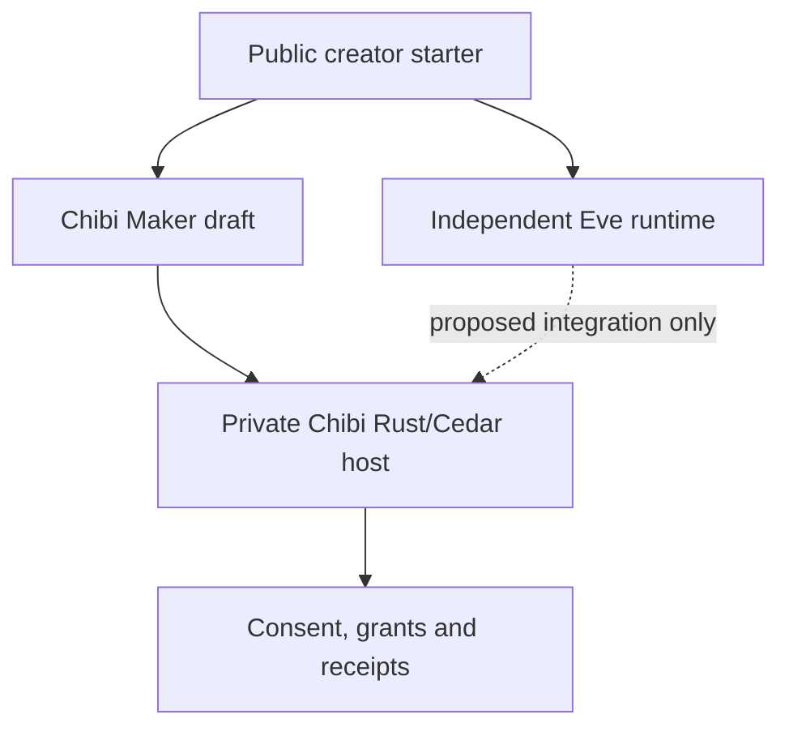

# Chibi × Vercel eve — creator starter

A small, customizable **Eve 1.1** agent intended to become a reusable Chibi.pet
creator template. This sample is for adults, is English-first, and can draft
learning or creative steps. It has **no Chibi identity, memory, payments,
entitlements, remote connections, or hosted deployment**.

## What is included

| File | Customize |
| --- | --- |
| `maker-draft.json` | Name, goal, introduction, instructions and example scenarios for the Chibi Maker editor |
| `agent/instructions.md` | The agent's conversational behavior and safety boundaries |
| `agent/capabilities.ts` | An illustrative capability/prerequisite graph (not access grants) |
| `agent/tools/*.ts` | Two side-effect-free typed Eve tools; the time-box tool only receives minutes, not the user's goal |
| `agent/agent.ts` | Model choice, disabled default tools and a session continuation threshold |
| `agent/instrumentation/local-otlp.ts` | Optional, metadata-only OpenTelemetry export through a local OTLP collector |
| `agent/telemetry-policy.ts` | Explicit opt-in, endpoint validation and exported-attribute allowlist |

## Run independently

Prerequisites: **Node.js 24+**, npm and a model credential accepted by Eve.
From this directory, not the Junction monorepo root:

```sh
npm ci --ignore-scripts
npm run check
npm run dev
```

The Eve terminal opens in local development. Sign in through its supported
`/login` flow if prompted, or use your own configured AI Gateway credentials.
`npm run check` compiles the agent but **does not make a model call**. `npm run
dev` can invoke a model and incur provider usage. Never paste secrets into
repository files. Change `model` in `agent/agent.ts` if your account supports a
different model; follow the model provider's data-processing terms. Eve,
workflow, hosting and model providers may process or retain conversation and
tool data; this starter does not promise zero telemetry or data retention.
The Eve continuation threshold is **not a hard spending cap**: model calls
can cross it before usage is reported, and infrastructure costs are separate.
Public hosting/rentals need host-enforced budgets, quotas and billing controls.

## Optional local observability (OpenTelemetry)

The starter includes a **disabled-by-default** Eve instrumentation hook. To
export **content-redacted spans** during a trusted local development session,
run an OTLP HTTP/protobuf collector on loopback first, then set:

```sh
CHIBI_EVE_OTLP_ENABLED=true \
CHIBI_EVE_OTLP_TRACES_URL=http://127.0.0.1:4318/v1/traces \
npm run dev
```

Only `http(s)://localhost`, `127.0.0.1` or `[::1]` endpoints with the exact
`/v1/traces` path are accepted. Direct cloud URLs and query credentials
are rejected. There are no observability keys in the template. **Use only a
trusted collector**: the underlying fetch exporter may follow HTTP redirects,
and the collector itself may forward data off-host. Endpoint validation alone
does not enforce a network egress firewall.
To try [Langfuse](https://langfuse.com/integrations/native/opentelemetry) or
[Phoenix](https://arize.com/docs/phoenix/tracing/how-to-tracing), explicitly
configure and approve a **separate** local collector with an appropriate OTLP
exporter or run a local Phoenix receiver. Langfuse's direct ingest URL is not
a supported starter endpoint; forwarding from a collector requires an
independent privacy, access and infrastructure review.

Eve's export policy suppresses prompt/reply content and restricts **span
attributes** to the `agent/telemetry-policy.ts` allowlist (for example model,
operation, token usage and error type). User messages, tool arguments, user
IDs and conversation IDs are excluded from those span attributes. Eve does
**not** apply that attribute filter to OTLP resource metadata, names or links:
a collector may still receive deployment or repository metadata. This is a
local-development building block, **not yet a verified PII-free OTLP payload**.
The policy controls **export only** and does not erase Eve's durable workflow
records or host/provider logs. Review synthetic captures of the whole payload,
collector retention and access before using real user data or forwarding
traces. Disable the collector to stop local export.

This hook does **not** authorize an agent action, supply a Chibi tenant ID,
alter the Rust worker's budgets or retry logic, create a Langfuse project, or
deploy a tracking service. No real traces are produced by `npm run check`.
Reported provider usage or cost is **not** a settled Chibi billing receipt.

### Open-source options considered

| Project | Reuse decision |
| --- | --- |
| [Langfuse](https://github.com/langfuse/langfuse) | Optional trace/evaluation UI downstream of a reviewed collector; self-hosting requires additional stateful services. MIT core with separate enterprise features. |
| [Arize Phoenix](https://github.com/Arize-ai/phoenix) | Good first **local** receiver/trace inspection candidate, using SQLite for evaluation; review its Elastic License 2.0 terms before product use. |
| [OpenLIT](https://github.com/openlit/openlit) | Apache 2.0 observability UI; its standard capture behavior needs explicit hardening around private conversations. |
| [OpenLLMetry](https://github.com/traceloop/openllmetry) | Apache 2.0 SDK instrumentation, but Eve already exposes its own OTel export integration; no extra runtime SDK needed. |
| [Helicone](https://github.com/Helicone/helicone) | API gateway/proxy option, not selected: Chibi must remain the sole policy, idempotency and budget authority. |

Keep the host-owned metadata counters and generic OTLP export format. Do not
build a separate controller, workflow queue or provider-routing proxy just for
observability. Before enabling any collector for real users, verify with
synthetic traces that **all** exported resources, events and span attributes
meet the privacy contract, then review tenant isolation, access, retention,
cost and consent. The starter itself makes no such production-readiness claim.

## Make it your own

1. Copy this directory into a new project (preserve its internal paths).
2. Edit `maker-draft.json`, `agent/instructions.md` and the capability graph.
3. Add only the typed, least-privileged tools your agent actually needs. The
   default shell, file-editing, web and delegation tools are disabled.
4. Run `npm run check`, then conduct an actual interactive model evaluation.
5. Decide separately whether to host on Vercel or another supported Node host.
   Before exposing browser traffic, configure real channel authentication;
   Eve's placeholder auth blocks production browser traffic by default.

This is **not yet a one-click Chibi Marketplace install**. The Maker draft can
be copied into `/maker/new` on Chibi.pet through its normal authenticated UI;
the optional WebMCP staging route, where supported, changes only the local
unsaved form. The private Chibi host must independently validate and approve
any eventual adoption, connection, capability grant or runtime execution.

## Production and marketplace boundary



The dashed integration is **not implemented**. A future host adapter must bind
tenant, actor, adopted source digest, effect, capability, budget and idempotency
key. The host rechecks policy and revocation before every privileged call and
reconciles uncertain effects before retry. Neither Eve's local session nor a
template capability declaration is a Chibi permission grant.

Before publishing a public template, confirm the license, onboarding UX,
supported hosting/identity paths, real model/provider acceptance, billing and
privacy wording. No deploy or Marketplace publication is performed here.

Useful upstream docs: [Eve getting started](https://eve.dev/docs/getting-started),
[built-in tools](https://eve.dev/docs/concepts/built-in-tools), and
[deployment/authentication](https://eve.dev/docs/guides/deployment).
