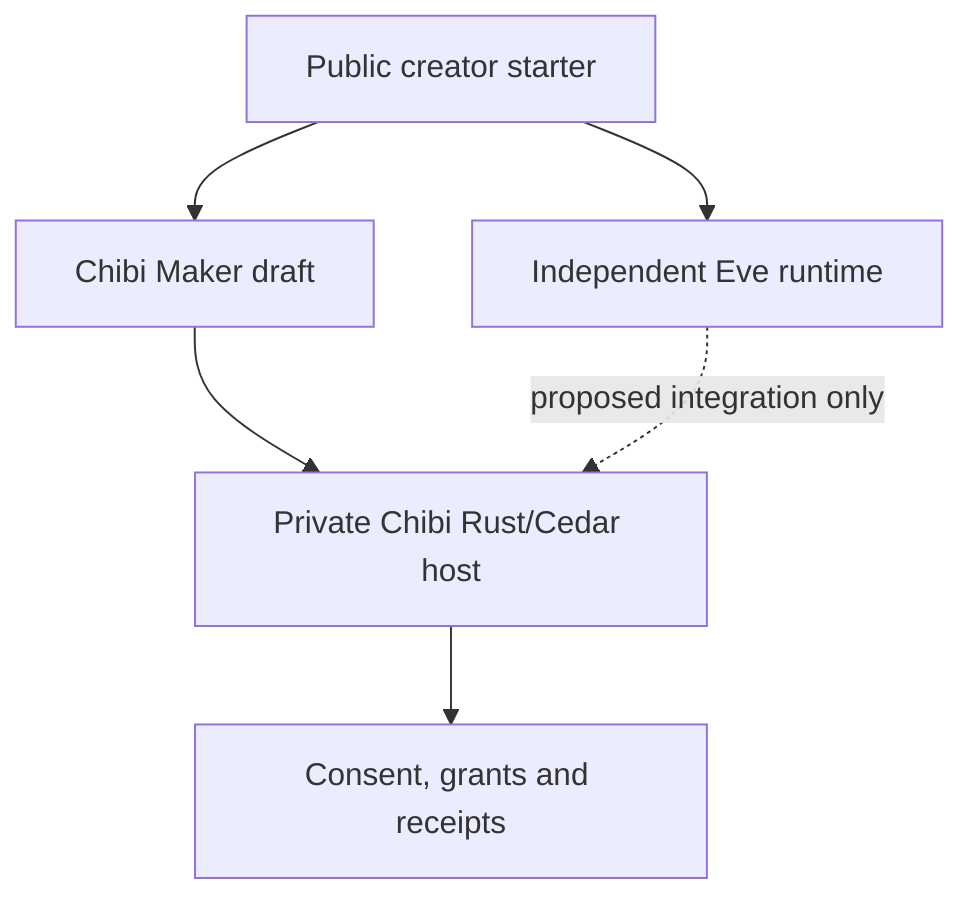

# Chibi × Vercel eve — creator starter

A small, customizable **Eve 1.1** agent intended to become a reusable Chibi.pet
creator template. This sample is for adults, is English-first, and can draft
learning or creative steps. It has **no Chibi identity, memory, payments,
entitlements, remote connections, or hosted deployment**.

## What is included

| File | Customize |
| --- | --- |
| `maker-draft.json` | Name, goal, introduction, instructions and example scenarios for the Chibi Maker editor |
| `agent/instructions.md` | The agent's conversational behavior and safety boundaries |
| `agent/capabilities.ts` | An illustrative capability/prerequisite graph (not access grants) |
| `agent/tools/*.ts` | Two side-effect-free typed Eve tools; the time-box tool only receives minutes, not the user's goal |
| `agent/agent.ts` | Model choice, disabled default tools and a session continuation threshold |

## Run independently

Prerequisites: **Node.js 24+**, npm and a model credential accepted by Eve.
From this directory, not the Junction monorepo root:

```sh
npm ci --ignore-scripts
npm run check
npm run dev
```

The Eve terminal opens in local development. Sign in through its supported
`/login` flow if prompted, or use your own configured AI Gateway credentials.
`npm run check` compiles the agent but **does not make a model call**. `npm run
dev` can invoke a model and incur provider usage. Never paste secrets into
repository files. Change `model` in `agent/agent.ts` if your account supports a
different model; follow the model provider's data-processing terms. Eve,
workflow, hosting and model providers may process or retain conversation and
tool data; this starter does not promise zero telemetry or data retention.
The Eve continuation threshold is **not a hard spending cap**: model calls
can cross it before usage is reported, and infrastructure costs are separate.
Public hosting/rentals need host-enforced budgets, quotas and billing controls.

## Make it your own

1. Copy this directory into a new project (preserve its internal paths).
2. Edit `maker-draft.json`, `agent/instructions.md` and the capability graph.
3. Add only the typed, least-privileged tools your agent actually needs. The
   default shell, file-editing, web and delegation tools are disabled.
4. Run `npm run check`, then conduct an actual interactive model evaluation.
5. Decide separately whether to host on Vercel or another supported Node host.
   Before exposing browser traffic, configure real channel authentication;
   Eve's placeholder auth blocks production browser traffic by default.

This is **not yet a one-click Chibi Marketplace install**. The Maker draft can
be copied into `/maker/new` on Chibi.pet through its normal authenticated UI;
the optional WebMCP staging route, where supported, changes only the local
unsaved form. The private Chibi host must independently validate and approve
any eventual adoption, connection, capability grant or runtime execution.

## Production and marketplace boundary



The dashed integration is **not implemented**. A future host adapter must bind
tenant, actor, adopted source digest, effect, capability, budget and idempotency
key. The host rechecks policy and revocation before every privileged call and
reconciles uncertain effects before retry. Neither Eve's local session nor a
template capability declaration is a Chibi permission grant.

Before publishing a public template, confirm the license, onboarding UX,
supported hosting/identity paths, real model/provider acceptance, billing and
privacy wording. No deploy or Marketplace publication is performed here.

Useful upstream docs: [Eve getting started](https://eve.dev/docs/getting-started),
[built-in tools](https://eve.dev/docs/concepts/built-in-tools), and
[deployment/authentication](https://eve.dev/docs/guides/deployment).
